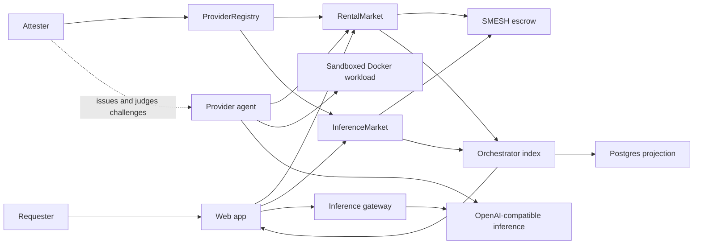

# ShaderMesh Demo and Presentation Guide

Use this guide for an 8 to 10 minute project review. It combines a short
presentation, a live demonstration, and answers to likely reviewer questions.

## One sentence

ShaderMesh is an Ethereum-coordinated marketplace where providers stake and rent
out compute, requesters fund time-based leases through escrow, and off-chain agents
run the actual workloads while smart contracts enforce payment and SLA consequences.

## Thirty-second explanation

GPU compute is expensive and concentrated in centralized clouds, while useful
hardware remains idle elsewhere. ShaderMesh lets independent providers list that
capacity and lets requesters lease it. Ethereum does not perform the computation.
It provides the neutral coordination layer for listings, escrow, staking, streamed
payment, reputation, and slashing. Provider agents run workloads off chain in
constrained Docker containers. A second mode supports deterministic tasks that can
be checked through optimistic re-execution.

## Architecture



The trust boundary is deliberate. Contracts control value and state. The web,
orchestrator, and provider agents are off-chain services and never replace the
contract as the payment authority.

## Presentation

### Slide 1: Project

**On screen**

- ShaderMesh
- Decentralized compute rental on Ethereum
- GPU leasing, managed inference, and verifiable tasks
- Team names and roll numbers

**Say**

> ShaderMesh is a decentralized marketplace for renting compute. Our primary use
> case is GPU capacity for AI workloads. Providers stake and list hardware,
> requesters lease it through on-chain escrow, and provider agents execute the
> workload off chain.

### Slide 2: Problem

**On screen**

- GPU supply is expensive and concentrated.
- Independent providers cannot easily sell idle capacity safely.
- Renters need transparent billing, refunds, and SLA enforcement.
- Providers need guaranteed payment without trusting the renter.

**Say**

> A normal marketplace must be trusted to hold funds, calculate usage, and decide
> disputes. ShaderMesh moves those economic rules into contracts so neither side
> controls settlement.

### Slide 3: Why blockchain

**On screen**

- Escrow funded before service starts
- Interval-based settlement
- Provider stake and lease bond
- Public reputation and attestation records
- Recurring benchmark challenges with slashing to a treasury
- Automatic refund and slashing paths

**Say**

> The blockchain is not used for compute. It is used where deterministic consensus
> matters: ownership, escrow, time-based settlement, stake, and penalties. Workloads
> remain off chain because putting GPU execution on Ethereum would be impractical.

### Slide 4: Rental lifecycle

**On screen**

1. Provider registers, stakes, and receives attestation.
2. Provider lists capacity, price, region, and supported models.
3. Requester approves SMESH and submits a manifest-bound funded request.
4. Provider validates the manifest and accepts or rejects the request.
5. Acceptance starts the lease clock, reserves the listing, and bonds provider stake.
6. Provider launches the lease workload and posts one heartbeat for each current interval.
7. Completed intervals in the contiguous heartbeat prefix release escrow to the provider.
8. Early end refunds unused escrow; a missed interval cannot be covered retroactively and
   permits termination and slashing after its deadline.

**Say**

> The request is funded in advance, but service does not start until the provider
> accepts its content-addressed manifest. The provider earns only for completed,
> consecutively heartbeated intervals. The requester can recover unused escrow, while
> the provider has bonded stake at risk for an SLA breach.

### Slide 5: Two trust models

| Mode | Example | Security model |
|------|---------|----------------|
| Rental | GPU lease, LLM inference, fine-tuning | Availability, attestation, stake, reputation, slashing |
| Verifiable task | Deterministic batch work | Result commitment, eligible challenger re-execution, vote, slashing |

**Say**

> An LLM response or training run cannot generally be reproduced exactly, so it is
> incorrect to claim that all AI compute is verifiable. Rentals use an availability
> and SLA model. Deterministic tasks use a separate optimistic verification game.
> Both modes share the same provider stake and reputation layer.

### Slide 6: Implementation

**On screen**

- Solidity: token, registry, rental market, job market, verification
- Solidity: inference offers and prepaid credits
- Python: provider, rental daemon, inference, hardware discovery, Docker execution
- TypeScript: durable Postgres projection, APIs, signed gateway, job orchestration
- Python: provider benchmark answers and the attester service that issues and judges challenges
- Next.js: landing page, role workspaces for renting and providing, and explorer (light and dark themes)
- Docker Compose: chain, deployer, IPFS, Postgres, provider, seed, attester, API, web

**Say**

> The local stack starts with one command. The deployment and seed services create
> real contract state. The provider daemon reads that state, launches a constrained
> lease container, and signs heartbeat transactions. The orchestrator persists its
> projection and exact event cursor in Postgres, restores it on restart, and replays
> only later chain events.

### Slide 7: What is real and what is seeded

**Real in the prototype**

- Solidity execution on a local Ethereum node
- Signed transactions, escrow, settlement, refund, bond, and slash logic
- Pending manifest-bound requests and provider acceptance or rejection
- Current-interval-only heartbeats with no retroactive coverage
- Durable event projection, ordered replay, APIs, and explorer history
- Wallet transaction support, including the provide workspace
- Prepaid inference credits, signed gateway requests, and requester usage settlement
- Gateway request-size, timeout, hostname allowlist, redirect, and replay controls
- Seeded benchmark challenges answered by the provider and judged by the attester, with free-stake slashing to a treasury and attestation revocation
- Lease-bound Docker container execution
- CPU, memory, PID, user, filesystem, capability, and network restrictions
- Task challenger operation and bounded RPC and IPFS retry
- Host hardware discovery for CPU, RAM, NVIDIA, Docker, and Ollama
- Sepolia deployment and live prepaid inference and GPU-container rental validation

**Seeded or incomplete in the local demo**

- Provider accounts and advertised GPU metadata
- Trusted attester that judges challenges, rather than an independent or decentralized verifier
- CPU placeholder workload instead of a real rented GPU workload
- Deterministic echo inference instead of Ollama or vLLM
- Direct provider transactions rather than independent availability probes or relayed heartbeats
- Requester-submitted inference usage rather than provider-signed usage receipts
- Local SMESH test token with a display peg of 1 SMESH to 1 USD

**Say**

> The reproducible local demo uses seeded hardware and echo inference. The same
> protocol is also deployed on Sepolia, where an attested RTX 4070 Laptop provider
> completed a prepaid request through its `qwen3:0.6b` offer and served a
> GPU-enabled rental container.

### Slide 8: Validation and CI

**On screen**

- Contracts: 42 passing tests
- Provider agent: 58 passing tests
- Orchestrator: 54 passing tests with Postgres and clean typecheck
- Simulator: 15 passing tests
- Web: lint, typecheck, production build, and 30 Playwright checks, including browser wallet-write flows
- Full Compose flow: three listings, one active lease, one workload container
- Sepolia: live 36-token inference payment and normally completed GPU rental
- GitHub Actions: five component jobs plus dependent full-stack smoke and browser job

**Say**

> Tests cover successful settlement, early refund, provider downtime and slashing,
> inference credits and authorization, Postgres replay, Docker sandbox controls,
> GPU gating, container recovery, retries, challenger behavior, and health-backed
> heartbeats. CI also starts a fresh stack and executes a paid inference smoke flow.
> The live Sepolia validation exercised both inference and rental paths.

### Slide 9: Remaining work

**On screen**

- A decentralized judge in place of the trusted attester
- Independent availability probes and relayed signed heartbeats
- Provider-signed inference usage or a settlement dispute mechanism
- Commit-reveal, reputation-weighted random selection, and SSIM verification
- Additional provider laptops and multi-provider evaluation
- Future work: Blender rendering with perceptual verification (descoped for this delivery)

**Say**

> The local protocol and operator tooling are implemented. Remaining work replaces
> the trusted benchmark judge and requester-metered usage with stronger evidence,
> hardens task verification, and adds more providers. All six deployed
> contracts are source-verified on Sepolia Etherscan.

### Slide 10: Live Sepolia record

**On screen**

- Chain ID: `11155111`
- Provider: `0xfd4e4A034601991A3070bD2B9B0F6a473a5bfc76`
- RTX 4070 Laptop, 8 GB, registered, staked, and attested
- Rental listing `#2`, 60-second intervals
- Inference offer `#1`, `qwen3:0.6b`
- Requester funded with 1,000 test SMESH
- All operator and provider containers healthy during validation on 17 September 2026

**Say**

> On Sepolia, prepaid inference served 36 tokens and paid
> `72000000000000` SMESH base units. Rental lease `#1` launched a GPU-enabled
> container, recorded two heartbeats, settled one interval, and ended normally.
> Two deterministic jobs executed, settled, and stitched to the same reproducible
> IPFS result. The Alchemy-backed indexer queried logs in 10-block chunks.

Contract addresses:

| Contract | Address |
|----------|---------|
| `SmeshToken` | `0x4d08515811A8b14A69aE3049278EDB04e83645F1` |
| `ProviderRegistry` | `0xd723DFd9E63632e9533ea1946b57AdB6d00cfC3f` |
| `JobMarket` | `0x9F3B0526A9c665F1Df423145eaACCe5b2479Ee57` |
| `Verification` | `0x994927B22613bCB8c5A25fA6386E386F250D365F` |
| `RentalMarket` | `0x0CcaB81947Ee0Dc270908FE0cd99f280596f3Ac3` |
| `InferenceMarket` | `0x108fF3eaeB81592A04212F52bEe50F46a0abf9D1` |

Requester: `0x7e6a268D9aa458f0deCE6280A7Eb9B86888565d8`.
All six contract addresses are source-verified on Sepolia Etherscan.

## Live Demo

### Preflight

Start from a clean local demo state shortly before presenting. This removes only
ShaderMesh's local Compose volumes and managed lease containers:

```powershell
docker compose down -v
$leaseContainers = docker ps -aq --filter "label=shadermesh.managed=true"
if ($leaseContainers) { docker rm -f $leaseContainers }
docker compose up --build -d
docker compose ps --all
```

Expected state:

- `chain`, `ipfs`, `postgres`, `orchestrator`, `provider`, `attester`, and `web` are running.
- `chain`, `ipfs`, `postgres`, and `provider` report healthy.
- `deployer` and `seed` exited with code 0 because they are one-shot services.

Open `http://localhost:3000`. It opens on the landing page, which explains the
protocol with diagrams (lease lifecycle, token flow, escrow by interval, heartbeat
strip, and challenge track). The app routes are `/dashboard`, `/rent`, `/leases`,
`/models`, `/provide` (with `/provide/capacity` and `/provide/stake`), and `/explorer`. The theme toggle switches between light
(default) and dark.

### Step 1: Home

Open `/dashboard`. The **Renting** and **Providing** panels summarize the connected wallet. The **Network now**, **Recent activity**, and **Available capacity** sections show network state. Point out:

- Three listed GPUs from three attested providers; one listing is reserved by the seeded lease.
- One active network lease.
- `$2.52` per hour streaming rate for the RTX 4090 listing.
- The active provider address `0x7099...79C8`.
- The 24-hour demo lease has already settled three ten-minute intervals.
- The lease manifest, accepted status, heartbeats, escrow, and bond.

Say:

> These values are not hard-coded UI cards. The seed service submitted transactions
> to the deployed contracts. The orchestrator indexed those contract events, and the
> dashboard reads the resulting API projection.

### Step 2: Marketplace

Open **Marketplace** (`/rent`) in the Rent group.

Show:

- The available A100 80GB and RTX 3090 listings. The RTX 4090 is reserved by lease `#1`.
- Provider addresses, region, VRAM, interval, and reputation.
- Different on-chain prices shown in USD using the demo token peg.

Say:

> A renter chooses a listing, configures intervals and the workload manifest in the three-step lease composer, reviews the lease, and requests it. The browser approves the
> escrow token and submits a pending request. The provider accepts only its exact
> configured manifest. The clock and bond start on acceptance, and funds are released
> only for completed intervals with uninterrupted heartbeat evidence.

### Step 3: Connect the seeded requester

Add this local network to MetaMask:

| Field | Value |
|-------|-------|
| Network | ShaderMesh Local |
| RPC URL | `http://127.0.0.1:8545` |
| Chain ID | `31337` |
| Currency symbol | `ETH` |

Import the seeded requester account using this public Hardhat test key only:

```text
0x47e179ec197488593b187f80a00eb0da91f1b9d0b13f8733639f19c30a34926a
```

This key is deterministic, publicly known, and has no value outside the local
development chain. Never send real assets to it.

Connect the wallet and open **My leases**. Show lease `#1`, its accepted status,
manifest, start time, escrow, bond, settled count, and heartbeat count. Do not end
the lease during the main demonstration because the overview and container proof
depend on it.

### Step 4: Managed inference

Open **Inference** (`/models`), select the `llama-3.1-8b` offer, and open a 1 SMESH prepaid
credit. Confirm the ERC-20 approval and `openCredit` transactions. Then enter:

```text
Explain how ShaderMesh protects a renter when a provider goes offline.
```

Sign the short-lived request authorization. After the completion returns, confirm
the cumulative usage settlement. Point out the credited provider, usage counters,
paid amount, and remaining escrow.

Say:

> The browser signs the credit ID, provider, model, message hash, unique request ID,
> and expiry. The gateway verifies that authorization, consumes the replay key in
> Postgres, and routes only to the credited provider. The browser then submits the
> provider-reported cumulative token counters to `InferenceMarket`, which pays the
> provider from escrow. The backend is deterministic echo, so this demonstrates
> authorization, routing, metering, and settlement rather than model quality.

### Step 5: Prove the workload is a real container

In a terminal, run:

```powershell
docker ps --filter "label=shadermesh.managed=true" `
  --format "table {{.Names}}`t{{.Status}}`t{{.Image}}"
```

Expected container:

```text
shadermesh-lease-0e0d17dc79c8-1
```

Inspect its enforced limits:

```powershell
$lease = docker ps --filter "label=shadermesh.managed=true" --format "{{.Names}}"
docker inspect $lease --format 'user={{.Config.User}} networkDisabled={{.Config.NetworkDisabled}} readonly={{.HostConfig.ReadonlyRootfs}} memory={{.HostConfig.Memory}} nanoCpus={{.HostConfig.NanoCpus}} pids={{.HostConfig.PidsLimit}} mounts={{json .Mounts}} devices={{json .HostConfig.DeviceRequests}}'
```

Expected important values:

```text
user=65532:65532
networkDisabled=true
readonly=true
memory=536870912
nanoCpus=500000000
pids=64
mounts=[]
devices=null
```

Say:

> The provider agent discovered the active lease and created this sibling container
> through the Docker API. It has no network, no host mounts, no GPU access, a read-only
> root filesystem, a non-root user, and fixed resource limits. The agent heartbeats
> only while this lease container is running and healthy.

### Step 6: Show chain-backed indexing

```powershell
Invoke-RestMethod http://localhost:4000/listings | ConvertTo-Json -Depth 6
Invoke-RestMethod http://localhost:4000/leases | ConvertTo-Json -Depth 6
Invoke-RestMethod http://localhost:4000/offers | ConvertTo-Json -Depth 6
docker compose logs provider --tail 20
```

Point out:

- Listing and lease IDs match the dashboard.
- The provider address matches the inference route.
- Provider logs report heartbeats for one active lease.
- The credit records match the selected inference offer and provider.

### Step 7: Provide workspace and explorer

Open **Node** (`/provide`) in the Provide group. Show provider health, stake, served work, benchmark challenges, and the **Provider registry** table. Then open **Capacity** (listings and inference offers) and **Stake** (faucet, register, stake, unstake). Explain that every mutation in this workspace is wallet signed. Then open **Explorer** and show the network token-flow figure, the lease
inspector, the **Challenges** tab, and the colour-coded event timeline with slashes,
all backed by the durable projection.

### Step 8: Benchmark challenge and slashing

Run this last. It ends with a revoked attestation and needs a full reset
afterwards. The full procedure is in section 6.8 of the
[demo runbook](ShaderMesh-Demo-Runbook.md).

1. In the explorer **Challenges** tab, show challenges with status `passed`. The
   attester issues one every 60 seconds in the local stack, and the provider answers
   automatically.
2. Restart only the provider with a fault switch:

   ```powershell
   $env:BENCHMARK_FAULT = "wrong_hash"
   docker compose up -d --no-deps provider
   ```

   `wrong_hash` submits a bad hash. `silent` never responds and fails at the 120
   second deadline.
3. Within one to two minutes the next challenge fails. In the **Challenges** tab it
   shows `failed, slashed` with 10 SMESH. In the event timeline, `ChallengeResolved`,
   `AttestationRevoked`, and `Slashed` appear in the danger colour.
4. The 10 SMESH goes to the treasury (the deployer, Hardhat account 0). It comes from
   free stake only, so the active lease keeps its bond. The provider loses its
   attestation and cannot publish new listings or offers.
5. Reset with `Remove-Item Env:BENCHMARK_FAULT` and the reset commands below.

Say:

> The attester issues a seeded challenge. The provider must return the result of a
> 500,000-step SHA-256 chain and a throughput score before the deadline. A wrong
> answer or a missed deadline costs the provider stake and its attestation. A missed
> deadline needs no trusted input, because anyone can close the challenge. The
> attester is still a trusted judge of answers, and a benchmark does not prove the
> exact GPU model.

### Pre-demo checklist for a live Sepolia run

Complete this before presenting on the public network.
Section 9.1 of the runbook has the full list.

- Sepolia ETH in the operator, attester, and provider wallets.
- RPC endpoint reachable, with the indexer log range matching the provider tier.
- Provider attested and `GET /challenges` showing recent `passed` challenges.
- Orchestrator indexer caught up to the chain head.
- `BENCHMARK_FAULT` unset on the provider.
- Local Hardhat stack built and ready as the fallback.

## Honest limitations

State these before a reviewer has to ask:

1. A provider heartbeat is currently a provider-signed assertion. A malicious
   provider could send one without serving useful compute. Benchmark challenges
   test responsiveness and throughput, but independent probes and requester evidence
   are required for stronger proof of service.
2. The attester is a trusted role. It records hardware and judges benchmark
   answers. A benchmark proves responsiveness, key control, and throughput, not the
   exact GPU model. The Sepolia deployment includes challenges, and the provider passes them live.
3. The contract binds an IPFS manifest and requires provider acceptance, but the
   current agent compares it to one configured allowlist value and runs a
   provider-configured workload. It does not parse and execute an arbitrary requester
   manifest.
4. The local inference backend is deterministic echo. The Sepolia validation completed
   a paid live request through offer `#1` for `qwen3:0.6b`.
5. Inference settlement is requester metered. The contract prevents another party from
   debiting the credit and prevents decreasing counters or overdraft, but it cannot
   independently detect requester under-reporting.
6. Sepolia deployment and both live market paths are validated with one provider and
   requester. This is not evidence of a decentralized multi-provider production network.
7. Docker socket access gives the provider agent significant host authority. A
   production system should add stronger isolation such as a dedicated worker host,
   rootless runtime, microVM, or sandboxed container runtime.

## Likely questions

### Is the computation performed on Ethereum?

No. Ethereum coordinates listings, escrow, stake, settlement, reputation, and
slashing. Compute executes off chain in provider containers.

### Why use blockchain instead of a normal database?

The value is neutral settlement between parties that do not trust each other. A
normal database would leave one marketplace operator in control of funds, billing,
and penalties.

### Is this a real GPU rental today?

The local demo uses seeded GPU metadata and a CPU workload. The Sepolia validation used
an attested RTX 4070 Laptop provider and launched a GPU-enabled lease container. A decentralized benchmark judge and broader hardware
validation remain open.

### Is the LLM response real?

The HTTP request, provider selection, route, response schema, and token metering are
real. A prepaid credit and requester signature authorize each call, and the requester
settles cumulative usage on chain. The local demo uses deterministic echo. The live
Sepolia provider completed and settled a 36-token request through its `qwen3:0.6b`
offer.

### Can the orchestrator steal funds?

No. It has no requester or provider private key and does not custody tokens. It
indexes events and routes HTTP requests. Value movement remains in contracts and
wallet-signed transactions.

### What prevents a provider from lying?

The current deterrents are stake, attestation records, recurring benchmark challenges
with slashing, public reputation, escrow, and slashing for missed heartbeats. A failed
or missed challenge costs up to 10 SMESH of free stake and the attestation. The attester
is a trusted judge and a benchmark cannot prove the exact GPU model, so independent
availability probes and a decentralized judge are the next milestones, not solved claims.

### What happens if the provider goes offline?

After the heartbeat interval and grace period pass, anyone can terminate the lease.
Served intervals are paid, unused escrow is refunded, and the provider's lease bond
is slashed to the renter.

### Why are there two market modes?

Some outputs can be objectively checked and some cannot. Deterministic rendering can
use re-execution. Interactive GPU rental and LLM inference require an availability
and SLA model. Applying one trust model to both would make incorrect guarantees.

## Closing statement

> ShaderMesh currently demonstrates the complete coordination path: providers stake
> and list capacity, renters submit manifest-bound requests, providers accept them,
> contracts stream escrow against strict interval heartbeats, agents execute constrained
> workloads, prepaid credits authorize inference, recurring benchmark
> challenges check that providers stay responsive and slash them if they do not, and
> the web app reads a durable chain projection. The next step is replacing the trusted
> judge and requester-metered usage with stronger evidence, broadening GPU validation,
> and hardening task verification across multiple provider laptops.

## Reset the demo

Use this only on the local development stack:

```powershell
docker compose down -v
$leaseContainers = docker ps -aq --filter "label=shadermesh.managed=true"
if ($leaseContainers) { docker rm -f $leaseContainers }
docker compose up --build -d
```

Wait until `docker compose ps --all` shows the provider as healthy, the attester as
running, and both one-shot services as exited with code 0 before opening the web app.
