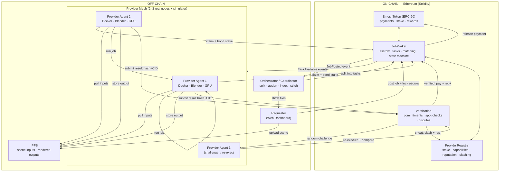
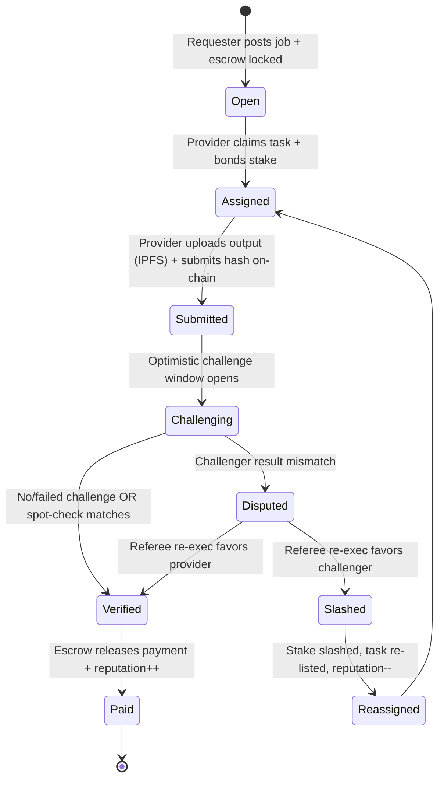
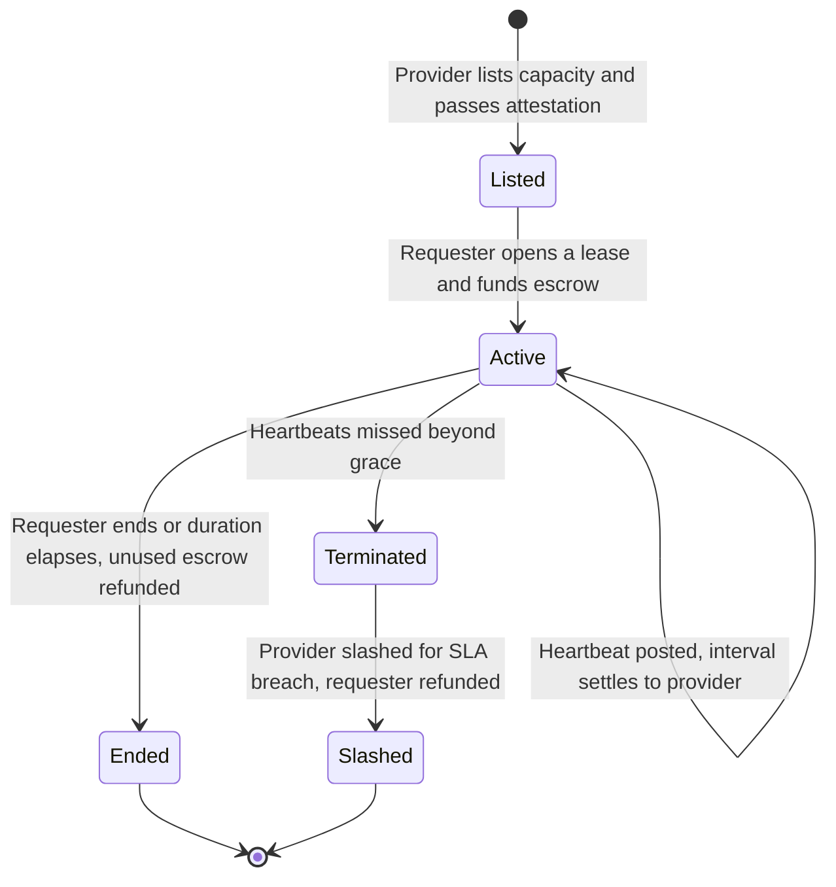
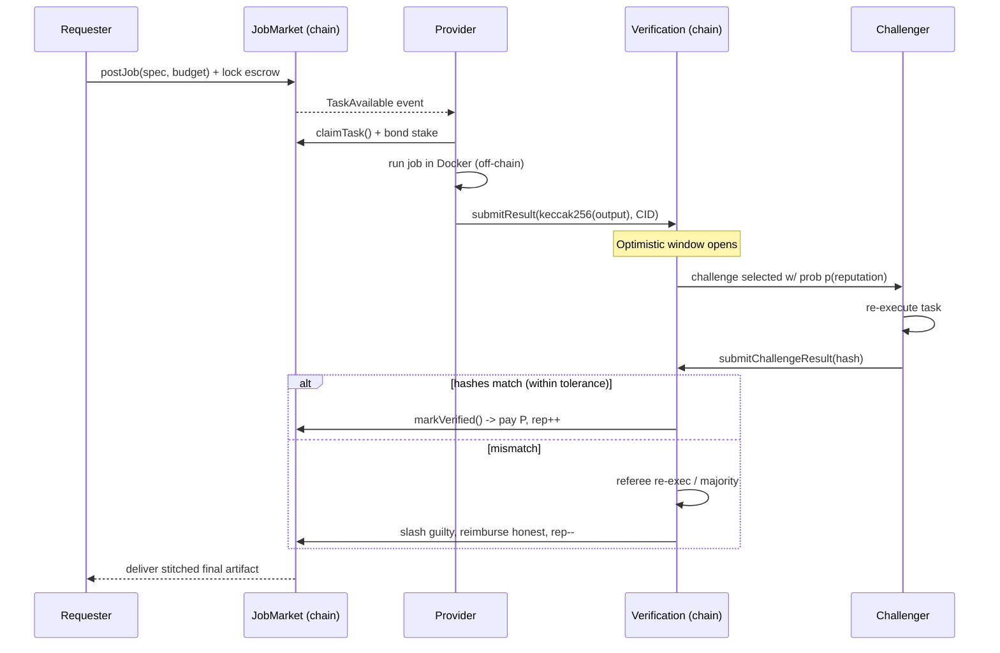

# ShaderMesh — Review 1: Proposal & Design

> A decentralized marketplace for renting compute on Ethereum, headlined by AI and LLM compute (managed inference plus raw GPU leases), generalized to any compute, with a retained verifiable-task mode.

**Course:** Blockchain / Cryptocurrency
**Review:** Review 1 (Proposal and Design), 09-09-26 to 16-09-26

> Note: the project was repositioned toward compute rental with an LLM focus. The
> authoritative, up to date scope and roadmap live in `docs/ShaderMesh-SRS.md`.

---

## 1. Project Title

**ShaderMesh: A Decentralized Marketplace for Renting Compute (LLM and AI first)**

*Subtitle: staking, uptime and attestation, reputation, and slashing secure rented compute; an optimistic re-execution game secures deterministic tasks. One coordination layer, two market modes.*

---

## 2. Team Members & Roll Numbers

| # | Name | Roll Number | Primary Responsibility |
|---|------|-------------|------------------------|
| 1 | _[Fill in]_ | _[Fill in]_ | Smart contracts (Solidity) & tokenomics |
| 2 | _[Fill in]_ | _[Fill in]_ | Provider compute agent & orchestrator |
| 3 | _[Fill in]_ | _[Fill in]_ | Web dashboard & verification/analytics |

> Replace the placeholders with your actual team roster before submission.

---

## 3. Problem Statement

### What problem is being addressed?

Demand for GPU compute, led by AI and large language models, is rising far faster than accessible supply. Capacity is concentrated in a few centralized clouds, while millions of capable GPUs sit idle in homes, studios, and labs. This creates four concrete problems:

1. **Scarce and expensive AI compute.** GPU rental for running and fine-tuning models is costly and often waitlisted, and prices are set by a small number of providers.
2. **Idle supply cannot be safely monetized.** An individual with a few GPUs cannot easily rent them to strangers, because payment, metering, uptime enforcement, and disputes are unsolved without a trusted intermediary that takes a large cut.
3. **Centralized trust and lock-in.** Renters depend on one company for availability, honest billing, and access, with no neutral guarantee and limited portability.
4. **No neutral settlement for a rental agreement.** Renting compute is a service agreement over time. Enforcing uptime, proving the advertised hardware, streaming payment, and refunding downtime require a neutral, automatic settlement layer.

### Why is blockchain and cryptocurrency relevant?

A rental marketplace between mutually distrusting strangers needs a neutral settlement and coordination layer. Blockchain provides exactly this:

- **Escrow with streamed settlement.** A contract holds the renter's funds and releases them to the provider per interval only while the service is proven live, and refunds unused time.
- **Staking and slashing.** Providers post collateral that is slashed for SLA breaches (downtime or failing a hardware attestation), making dishonest listings unprofitable.
- **On-chain reputation.** A tamper-proof, portable record of uptime and outcomes that no single company controls.
- **Utility-token payments.** Per-interval and per-request settlement without banks or chargebacks.
- **Transparent, auditable rules.** Pricing, leasing, attestation, and dispute logic live in open contracts.

Because a rented result (an LLM response, a training run) cannot be re-executed and checked, trust is availability based: uptime heartbeats, hardware attestation, reputation, and slashing. For deterministic jobs with a checkable output (rendering, batch), the marketplace retains an optimistic re-execution game. The blockchain is never used to do the compute; it is the trust, coordination, and payment layer around off-chain compute.

---

## 4. Objectives

1. **Design a decentralized compute-rental marketplace** on Ethereum with on-chain listings, leases, streamed escrow, provider staking, and settlement via smart contracts.
2. **Secure rented compute without result verification** using staking, signed uptime heartbeats, hardware attestation or benchmark challenges, reputation, and slashing for SLA breaches.
3. **Specialize in LLM and AI compute** by offering a managed, provider-served, OpenAI-compatible inference endpoint and raw GPU leases for running or fine-tuning models, while generalizing to any containerized workload.
4. **Retain a verifiable-task mode** for deterministic jobs (rendering, batch) using an optimistic re-execution game (staking, reputation, randomized spot-checking, slashing), reusing the same staking and reputation layer.
5. **Deliver a live 2 to 3 node prototype** (lease a GPU, serve an LLM through the gateway, stream payment, and run a verifiable job) plus a simulator, and **evaluate** deterrence, cost, attacker resistance, and gas.

---

## 5. Motivation / Need for the Project

- **Economic:** Trillions of idle GPU-hours exist worldwide (gaming PCs, render farms between projects, university labs at night). A permissionless market unlocks this supply and undercuts centralized cloud pricing.
- **Technical:** "Verifiable outsourced computation" is a genuinely hard, actively-researched problem (TrueBit, optimistic rollups, Livepeer's probabilistic verification). Building a working, honest-by-incentive system is a substantial and resume-defining engineering achievement.
- **Educational (course fit):** The project exercises the *full* blockchain skill set — ERC-20 tokens, escrow, staking/slashing, on-chain state machines, event-driven off-chain agents, dispute resolution, and mechanism design — far beyond a toy "hello world" dApp.
- **Practical:** Unlike price-speculation projects, ShaderMesh produces a *tangible, visible output* (a rendered image assembled from many machines), which makes for a compelling live demo and a clear correctness signal.

---

## 6. Literature Survey

> Minimum 5–10 relevant works, their approach, and the gap ShaderMesh addresses.

| # | Work | Approach | Limitation / Gap |
|---|------|----------|------------------|
| 1 | **Nakamoto (2008), _Bitcoin_** | PoW ledger; trustless value transfer between strangers. | No general computation; no marketplace for compute. |
| 2 | **Buterin (2014) / Wood, _Ethereum White/Yellow Paper_** | Turing-complete smart contracts enabling escrow, tokens, staking. | On-chain compute is far too expensive for real workloads; needs an off-chain execution layer. |
| 3 | **Golem (2016) Whitepaper** | Ethereum-based P2P compute market; began with Blender rendering. | Verification largely trust/redundancy based; complex UX; generalization and robust verification remained weak. |
| 4 | **Render Network (OTOY) Whitepaper** | Marketplace specifically for GPU 3D rendering (Octane). | Rendering-only; verification leans on reputation/manual review; relatively centralized coordination. |
| 5 | **Akash Network Docs/Whitepaper** | Decentralized cloud (Docker/K8s) via reverse-auction; Cosmos-based. | Focus on *availability/liveness*, not *correctness verification* of results; SDL/K8s complexity. |
| 6 | **Truebit — Teutsch & Reitwießner (2017)** | Interactive **verification game** (challenger + on-chain bisection referee) for scalable off-chain compute. | Complex multi-round on-chain disputes; high implementation cost; not tailored to rendering. |
| 7 | **Livepeer — Petkanics & Tang (2018)** | Decentralized video transcoding with **probabilistic (spot-check) verification** + staking. | Domain-specific to transcoding; ShaderMesh generalizes the spot-check + reputation idea. |
| 8 | **iExec — Fedak et al. (2018)** | Decentralized cloud using **TEE (Intel SGX) attestation** for trust. | Hardware-dependent (SGX); trusted-hardware assumptions; not commodity-GPU friendly. |
| 9 | **Filecoin — Protocol Labs (2017)** | Marketplace for *storage* with Proof-of-Replication / Proof-of-Spacetime. | Solves verifiable *storage*, not verifiable *computation*; useful as a design analogue. |
| 10 | **Bittensor — Rao et al. (2021)** | Decentralized ML network with "proof of intelligence" peer scoring. | Verification is subjective/peer-ranked; specific to ML; not deterministic-result checking. |
| 11 | **Arbitrum — Kalodner et al. (2018, USENIX Security)** | **Optimistic** execution: assume honest, allow a challenge window, dispute only if contested. | Designed for L2 transactions, not compute jobs; ShaderMesh borrows the optimistic + challenge-window pattern. |
| 12 | **OpenZeppelin Contracts (tooling)** | Audited, reusable ERC-20 / access-control / security primitives. | A building block, not a solution; we compose these into the marketplace. |

**Synthesis of the gap:** Existing systems are either (a) **domain-locked** (Render = rendering only, Livepeer = video only), (b) rely on **heavy/complex verification** (Truebit's multi-round disputes), (c) depend on **special hardware** (iExec/SGX), or (d) optimize **liveness not correctness** (Akash). **ShaderMesh's contribution** is a *generalized containerized job abstraction* with a *pluggable, low-overhead optimistic verification policy* (staking + reputation-weighted randomized re-execution + slashing), demonstrated end-to-end on distributed GPU rendering, and shipped as an open, reproducible reference implementation on commodity hardware.

---

## 7. Existing System

### Current methods

- **Centralized cloud GPU (AWS/GCP/Azure, CoreWeave, Lambda):** rent GPUs by the hour from one company.
- **Centralized render farms (SaaS):** upload a scene, they render it on their farm.
- **First-gen decentralized networks (Golem, Render, Akash):** P2P marketplaces with token payments.

### Problems / limitations

| Dimension | Centralized cloud / render farm | First-gen decentralized |
|-----------|-------------------------------|-------------------------|
| Trust | Single company; opaque billing; possible censorship. | Better, but often weak/optional result verification. |
| Price | Oligopoly list pricing; no supply-side competition from individuals. | Improving, but liquidity and UX are hard. |
| Supply | Individuals can't easily sell idle GPUs. | Onboarding & metering complexity. |
| Correctness proof | None — you trust the invoice. | Redundancy or reputation only; collusion-prone or expensive. |
| Payment | Bank/card, chargebacks, KYC friction. | Token payments, but volatile UX. |

---

## 8. Proposed System

### Solution

**ShaderMesh** is a blockchain-coordinated marketplace with two modes over one staking, reputation, and slashing layer.

**Rental mode (primary), for renting compute including LLMs:**

1. A **Provider** stakes, registers hardware, and lists capacity with a price per interval, and passes a **benchmark or attestation** challenge that proves the advertised GPU.
2. A **Requester** opens a **lease** against a listing and funds **escrow** for the duration. Escrow **streams** to the provider per interval.
3. The provider serves the lease: it launches the requester's container, exposes the leased GPU, or serves a model through an **OpenAI-compatible inference endpoint**, and posts a **signed uptime heartbeat** each interval.
4. Each interval settles to the provider only if a valid heartbeat exists. Missed heartbeats let anyone terminate the lease, refund unused time to the requester, and **slash** the provider for the SLA breach. Reputation updates from uptime.
5. For managed inference, requests are routed through the orchestrator **gateway**, metered, and paid from prepaid credits. An optional deterministic spot-check feeds reputation.

**Verifiable-task mode (retained), for deterministic jobs such as rendering:**

1. A requester posts a job and locks escrow; a thin orchestrator splits it into tasks.
2. Staked providers claim tasks, execute off chain in Docker, store outputs on IPFS, and submit a result commitment.
3. A reputation-weighted random subset is re-executed by challengers. A match pays the provider; a mismatch slashes the cheater and rewards the honest challenger.

### Advantages

- **Fits the actual trust model.** Rented compute is secured by availability and attestation, not by pretending an LLM result can be re-verified.
- **LLM and AI first, yet general.** A managed inference endpoint and raw GPU leases cover the headline use case, and any container can be rented or run.
- **Trustless in both directions.** Streamed escrow protects the renter from downtime; staking and slashing protect against false listings and SLA breaches.
- **Cheap verification where it applies.** Deterministic jobs use risk-weighted spot-checks, so honest work stays low overhead.
- **Permissionless supply.** Anyone with a GPU can stake, attest, and earn.
- **Transparent and auditable.** Listings, leasing, attestation, and dispute logic live in open contracts.

---

## 9. Blockchain Concepts Used

- **Blockchain type:** **Public** (Ethereum — local Foundry/Hardhat devnet for development → **Sepolia testnet** for the public demo). The design is portable to an EVM **L2 (Polygon/Arbitrum)** for low fees, and could be deployed as a **consortium** chain (Hyperledger/permissioned) for an enterprise variant — noted as future work.
- **Consensus mechanism:** We **inherit Ethereum's Proof-of-Stake** for ledger security and do not build a base-layer consensus. Our contribution is application-layer mechanism design: an availability-based rental agreement (streamed escrow, heartbeats, attestation, SLA slashing) and an optimistic re-execution game for deterministic tasks.
- **Smart contracts (Solidity):**
  - `SmeshToken`: ERC-20 utility token for payments, staking, and rewards.
  - `ProviderRegistry`: registration, staking, structured capabilities, hardware attestation, reputation, slashing.
  - `RentalMarket` (next phase): listings, leases, per-interval streamed escrow, signed heartbeats, extend and end, SLA slashing.
  - `JobMarket`: verifiable-task posting, escrow, claiming, state machine, settlement.
  - `Verification`: result commitments, spot-check scheduling, dispute resolution, reward and slash.
- **Cryptocurrency and token:** **SMESH**, an ERC-20 utility token used for paying for compute, provider stake and collateral, and rewards. It is a utility and test token for the platform, not an investment instrument. Cryptographic primitives used: keccak256 commitments, EIP-712 signed heartbeats, commit and reveal for challenge fairness, and content-addressed storage (IPFS CIDs).

---

## 10. System Architecture / Block Diagram

**Repositioned design:** the diagram above shows the verifiable-task flow that is built today.
The repositioned system adds a `RentalMarket` contract (listings, leases, streamed escrow,
heartbeats, SLA slashing), attestation in `ProviderRegistry`, and an inference gateway in the
orchestrator that routes OpenAI-compatible requests to providers. See `docs/ShaderMesh-SRS.md`
for the full block diagram and the rental and inference interfaces.

**Trust boundary:** the orchestrator is deliberately thin and untrusted. It cannot steal funds
or force acceptance of a result, because all value movement and validation happen on chain. The
inference gateway routes and meters requests but custodies no funds; settlement is on chain. If
the orchestrator misbehaves, the worst case is degraded liveness, not loss of funds.

---

## 11. Modules

1. **Token (`SmeshToken`)**: ERC-20 for payments, staking, and rewards, with a testnet faucet.
2. **Identity, staking, attestation (`ProviderRegistry`)**: registration, stake, structured capabilities (GPU model, VRAM, CPU, region), a benchmark or attestation challenge that proves advertised hardware, an EMA reputation over uptime and outcomes, and slashing hooks.
3. **Rental market (`RentalMarket`)**: listings, leases, per-interval streamed escrow, signed uptime heartbeats, extend and end, refunds for unused time, and SLA slashing. This is the primary market and where LLM serving runs.
4. **Verifiable-task market (`JobMarket`)**: job posting with escrow, task metadata, claiming, the task state machine, and settlement.
5. **Verification and dispute (`Verification`)**: result commitments, reputation-weighted random spot-checks, commit and reveal challenges, dispute resolution, reward and slash.
6. **Provider node agent (off-chain, Python)**: serves leases (launches the requester's container or exposes the GPU), signs heartbeats, responds to attestation challenges, serves models through an OpenAI-compatible endpoint, and in task mode claims, executes in Docker, and submits commitments, including challenger mode.
7. **Orchestrator (off-chain, TypeScript)**: indexes listings, leases, jobs, and events; routes managed inference through an OpenAI-compatible gateway with metering and health-aware routing; splits and stitches verifiable jobs. It custodies no funds.
8. **Storage (IPFS)**: content-addressed storage for inputs, outputs, and manifests; only CIDs and hashes go on chain.
9. **Web dashboard (off-chain, Next.js + wagmi/viem)**: rent GPUs and monitor leases, a model catalog and playground, verifiable jobs with live tile assembly, a provider console, and an explorer.
10. **Simulator**: models both trust economies (verification spot-checks, and rental uptime and SLA slashing) across honest, lazy, and malicious populations to show deterrence and scaling.

---

## 12. Technology Stack

| Layer | Choice | Why |
|-------|--------|-----|
| **Blockchain platform** | Ethereum — Foundry (Anvil) local devnet → Sepolia testnet; portable to Polygon/Arbitrum L2 | Best tooling, grader familiarity, free testnets. |
| **Smart-contract language** | Solidity 0.8.x + OpenZeppelin | Standard, audited primitives (ERC-20, AccessControl, ReentrancyGuard). |
| **Contract tooling / tests** | Hardhat (primary; TS-native) + optional Foundry for fuzzing | Node-native, matches team TS skills; Hardhat local node for the devnet. |
| **Provider agent** | Python 3.11, `web3.py`, Docker SDK, Blender CLI | Glue for Docker, chain events, heartbeats, and job execution. |
| **LLM inference runtime** | vLLM or Ollama in the provider container; small model fallback for CPU demos | Serves an OpenAI-compatible endpoint; the fallback keeps the demo GPU-optional. |
| **Orchestrator / gateway** | Node.js + TypeScript, `ethers`, IPFS client | Event indexing, split and stitch, OpenAI-compatible gateway with metering. |
| **Frontend** | Next.js + React + TypeScript + `wagmi`/`viem` + Tailwind | Modern dApp UX; MetaMask and WalletConnect integration. |
| **Storage** | IPFS (Kubo node / web3.storage) | Content-addressed inputs and outputs; on chain stores only CIDs. |
| **Compute runtime** | Docker (+ NVIDIA Container Toolkit for GPU); Blender headless | Reproducible, sandboxed lease and job execution across machines. |
| **Attestation** | Benchmark challenge (throughput or hash) signed by the provider; EIP-712 heartbeats | Proves advertised hardware and liveness without special hardware. |
| **Datastore / indexer** | PostgreSQL + Prisma (or The Graph subgraph) | Query on-chain + off-chain state for the dashboard. |
| **Dev infra** | docker-compose (chain + IPFS + orchestrator + N agents), GitHub, CI | One-command local devnet; reproducible demos. |
| **Optional (Rust/Go)** | A high-performance provider agent variant | Leverages team Rust/Go skill; stretch goal. |

---

## 13. Methodology / Workflow

### Job lifecycle (state machine)

### Lease lifecycle (rental, primary)

### Verification game (sequence)

### Development methodology

Agile and iterative, contract first:
1. Model and specify the economic rules and state machines (lease and task).
2. Contracts and tests first, using Hardhat unit and property tests for escrow, streaming, staking, and slashing.
3. Provider agent against a local devnet: rental serving with heartbeats and an inference endpoint, then task execution.
4. Integrate the orchestrator (gateway, index) plus IPFS and the dashboard.
5. Adversarial testing via the simulator (downtime and SLA breaches for rentals; lazy, false-result, and collusion for tasks).
6. Deploy to Sepolia and record the live demo.

### The verifiability nuance (design depth)

GPU rendering can be **non-deterministic** across different GPUs (floating-point differences), so naive exact-hash comparison can false-positive as "cheating." Our mitigations:
- **Pin the environment:** identical Docker image, Blender version, seed, and render settings.
- **Deterministic mode** for verifiable tasks (fixed tile size, CPU or deterministic GPU path).
- **Tolerant comparison:** compare via **perceptual hash / SSIM** above a threshold rather than exact bytes for GPU outputs; reserve exact keccak256 for deterministic containers.
This nuance is a first-class part of the "verification policy" attached to each job type.

---

## 14. Dataset / Input Details

This is a compute marketplace rather than an ML dataset project, but we standardize a small suite for reproducible demos and evaluation:

- **LLM inference inputs:** a small open-weights model served through the OpenAI-compatible endpoint (a compact model or a CPU-served fallback so the demo does not require a data-center GPU), with a fixed prompt set for metering and optional deterministic spot-checks.
- **Rental workloads:** a container that exercises the leased GPU or CPU (a short fine-tune or a benchmark), used to demonstrate uptime heartbeats and streamed settlement.
- **Rendering inputs (verifiable task):** open-source Blender scenes and a deterministic Mandelbrot tile job, split into tiles and frames for spot-check verification and stitching.
- **Adversarial inputs (simulator):** scripted provider behaviors: for rentals, downtime and false hardware claims; for tasks, lazy, false-result, and colluding behavior.

All inputs and outputs are stored on IPFS; only CIDs, hashes, and heartbeats are recorded on chain.

---

## 15. Expected Outcomes

1. **Working smart-contract suite** on Sepolia (token, registry with attestation, rental market, job market, verification) with passing Hardhat unit and property tests.
2. **Live rental demo:** lease a GPU across 2 to 3 nodes, serve a small LLM through the OpenAI-compatible gateway, post signed heartbeats, stream escrow per interval, and show uptime and spend in the dashboard. A simulated outage terminates the lease and slashes the provider.
3. **Live verifiable-task demo:** a deterministic render split across machines, verified on chain, paid, and stitched into a final image assembling live in the dashboard.
4. **Evaluation:** rental deterrence (uptime enforcement and SLA slashing) and task deterrence (spot-check cost versus security), plus reputation dynamics with N providers from the simulator.
5. **Gas and cost report** for each on-chain operation across both markets.
6. **Open-source repository** with documentation and a recorded demo, suitable for a portfolio.

---

## 16. Project Timeline / Work Plan

The authoritative, repositioned roadmap (with rental and LLM phases) is in
`docs/ShaderMesh-SRS.md` section 11. Phases 1 to 4 are already built and tested. The table
below is the original high-level plan and is kept for context. Assumes a 12 to 14 week
semester after Review 1.

| Phase | Weeks | Deliverable |
|-------|-------|-------------|
| **R1 — Proposal & Design** *(now)* | 0–1 | This document, architecture, repo scaffold, initial contract skeletons. |
| **P1 — Core contracts** | 2–3 | `SmeshToken`, `ProviderRegistry`, `JobMarket` (escrow + state machine) + Foundry tests. |
| **P2 — Verification game** | 4–5 | `Verification` contract: commit–reveal, spot-check scheduling, slashing, disputes. |
| **P3 — Provider agent + IPFS** | 5–6 | Python agent: claim → Docker/Blender → IPFS → submit; local devnet integration. |
| **P4 — Orchestrator + splitting/stitching** | 6–7 | Job splitter, event indexer, tile stitcher; end-to-end on Anvil. **← Review 2 (mid) target** |
| **P5 — Web dashboard** | 8–9 | Requester + provider + explorer UI; wallet integration. |
| **P6 — Simulator + adversarial tests** | 9–10 | N-provider simulation; attacker strategies; robustness metrics. |
| **P7 — Testnet deploy + hardening** | 11 | Sepolia deployment; security pass (reentrancy, access control). |
| **P8 — Evaluation + docs + demo** | 12–13 | Gas/verification/scaling report; recorded demo; final report. **← Final Review** |

```mermaid
gantt
    dateFormat  X
    axisFormat %s
    title ShaderMesh Work Plan (weeks)
    section Contracts
    Token+Registry+Market   :0, 4
    Verification game       :4, 2
    section Off-chain
    Provider agent + IPFS   :5, 2
    Orchestrator split/stitch :6, 2
    Web dashboard           :8, 2
    section Eval
    Simulator + attacks     :9, 2
    Testnet + hardening     :11, 1
    Evaluation + demo       :12, 2
```

---

## 17. References

1. S. Nakamoto, "Bitcoin: A Peer-to-Peer Electronic Cash System," 2008.
2. V. Buterin, "Ethereum: A Next-Generation Smart Contract and Decentralized Application Platform" (White Paper), 2014.
3. G. Wood, "Ethereum: A Secure Decentralised Generalised Transaction Ledger" (Yellow Paper), 2014.
4. The Golem Project, "The Golem Whitepaper," 2016.
5. J. Benet et al. / Protocol Labs, "Filecoin: A Decentralized Storage Network," 2017.
6. J. Teutsch and C. Reitwießner, "A Scalable Verification Solution for Blockchains" (TrueBit), 2017.
7. D. Petkanics and E. Tang, "Livepeer Whitepaper: Protocol and Economic Incentives For a Decentralized Live Video Streaming Network," 2018.
8. G. Fedak et al., "iExec Whitepaper: Blockchain-Based Decentralized Cloud Computing," 2018.
9. OTOY / Render Network, "The Render Network Whitepaper."
10. Overclock Labs, "Akash Network: Decentralized Compute Marketplace" (documentation/whitepaper).
11. Y. Rao et al., "Bittensor: A Peer-to-Peer Intelligence Market," 2021.
12. H. Kalodner et al., "Arbitrum: Scalable, Private Smart Contracts," USENIX Security Symposium, 2018.
13. OpenZeppelin, "OpenZeppelin Contracts, Secure Smart Contract Library" (documentation).
14. io.net, "A Decentralized Network for GPU Compute" (documentation), 2024.
15. W. Kwon et al., "Efficient Memory Management for Large Language Model Serving with PagedAttention" (vLLM), SOSP, 2023.
16. Vast.ai, "Decentralized GPU Rental Marketplace" (documentation).

---

## Review 1 Deliverables — Checklist

- [x] **Problem statement and objectives** (sections 3 and 4)
- [x] **Literature survey** (section 6)
- [x] **Architecture and design** (section 10 block diagram, section 11 modules)
- [x] **Methodology** (section 13: lease and task lifecycles, verification game, dev process)
- [x] **Technology stack** (section 12)
- [x] **Project report and documentation** (this document and `docs/ShaderMesh-SRS.md`)
- [x] **Initial prototype** (built and tested: token, registry, job market, verification, agent, orchestrator, simulator)
- [ ] **PPT** to be generated from this document

> Repositioned direction: compute rental with an LLM focus, two market modes. Built so far:
> the verifiable-task path end to end. Next: the rental market, attestation, and the managed
> inference layer. The authoritative roadmap is `docs/ShaderMesh-SRS.md` section 11.
