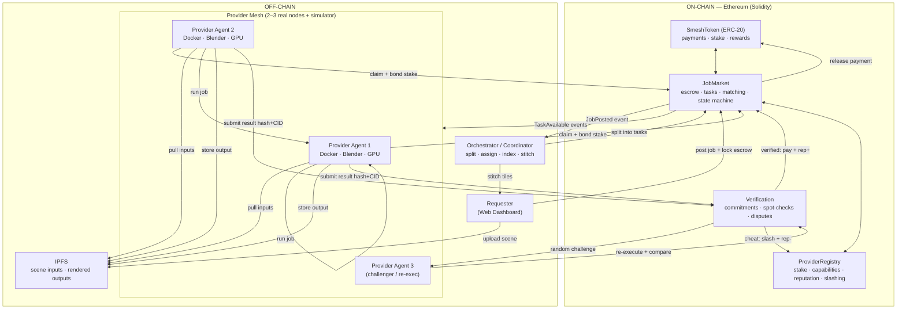
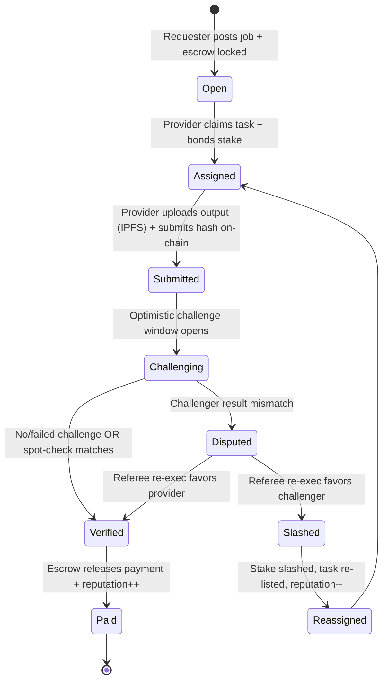
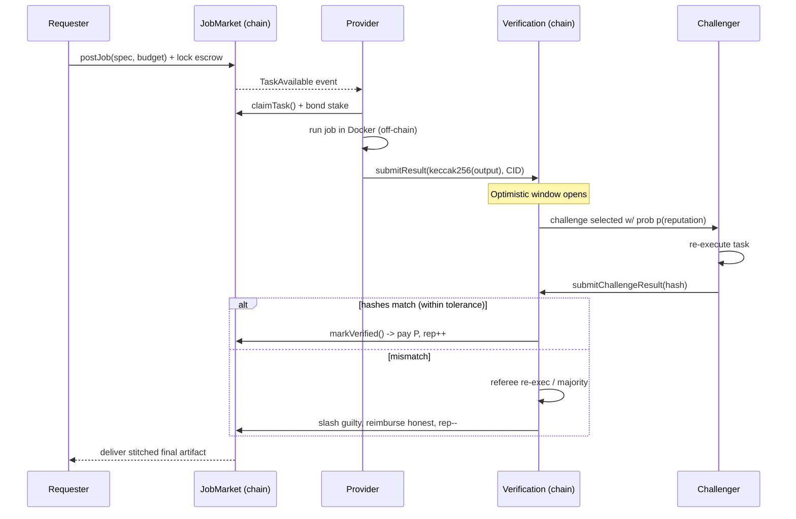

# ShaderMesh — Review 1: Proposal & Design

> A decentralized, verifiable marketplace for GPU/CPU compute — built on Ethereum smart contracts, with GPU rendering as the flagship workload.

**Course:** Blockchain / Cryptocurrency
**Review:** Review 1 — Proposal & Design (09-09-26 → 16-09-26)

---

## 1. Project Title

**ShaderMesh — A Decentralized, Verifiable Marketplace for GPU/CPU Compute**

*Subtitle: Optimistic staking + reputation + randomized re-execution for trustless off-chain compute, demonstrated on distributed GPU rendering.*

---

## 2. Team Members & Roll Numbers

| # | Name | Roll Number | Primary Responsibility |
|---|------|-------------|------------------------|
| 1 | _[Fill in]_ | _[Fill in]_ | Smart contracts (Solidity) & tokenomics |
| 2 | _[Fill in]_ | _[Fill in]_ | Provider compute agent & orchestrator |
| 3 | _[Fill in]_ | _[Fill in]_ | Web dashboard & verification/analytics |

> Replace the placeholders with your actual team roster before submission.

---

## 3. Problem Statement

### What problem is being addressed?

Demand for GPU/CPU compute (3D rendering, simulation, ML training/inference, batch jobs) is exploding, but supply is locked inside a handful of centralized clouds (AWS, GCP, Azure). This creates four concrete problems:

1. **High cost & poor price discovery.** Renters pay list prices set by an oligopoly; idle GPUs in homes, studios, and labs sit unused with no easy way to be monetized.
2. **Centralized trust.** You must trust one provider for correctness, availability, billing honesty, and censorship-resistance. There is no cryptographic guarantee that the work was actually done correctly.
3. **No permissionless supply side.** An individual with 3 idle GPUs cannot easily and safely sell that capacity to strangers — payment, metering, and dispute-handling are unsolved without an intermediary that takes a large cut.
4. **Weak verifiability of outsourced computation.** When you send a job to a remote machine, how do you *prove* the returned result is correct and not fabricated to collect payment? This is the central unsolved problem of decentralized compute.

### Why is blockchain/cryptocurrency relevant?

A compute marketplace between mutually-distrusting strangers needs a neutral settlement and coordination layer. Blockchain provides exactly this:

- **Escrow & atomic settlement** — a smart contract holds the renter's payment and releases it *only* when work is proven, removing counterparty risk in both directions.
- **Staking & slashing** — providers post collateral that is programmatically **slashed** if they cheat, making dishonesty economically irrational (skin-in-the-game).
- **On-chain reputation** — a tamper-proof, portable track record that no single company controls.
- **Micropayments via a utility token** — per-tile / per-task payments settle without banks or chargebacks.
- **Transparent, auditable rules** — the matching, pricing, verification, and dispute logic live in open smart contracts that anyone can audit.

The blockchain is **not** used to do the heavy compute (that is impossible/absurd on-chain). It is used as the **trust, coordination, and payment layer** around off-chain computation — the correct and defensible use of the technology.

---

## 4. Objectives

1. **Design a trustless compute marketplace** on Ethereum with on-chain job posting, escrow, provider staking, matching, and settlement via smart contracts.
2. **Implement an optimistic verification game** (staking + reputation + randomized re-execution / spot-checking + slashing) that makes cheating economically unprofitable without re-running every job.
3. **Build a generalized job abstraction** that runs any containerized (Docker) workload, with **GPU rendering (Blender / shader frames)** as a fully-working, visually verifiable flagship use case.
4. **Deliver a live 2–3 node prototype** where real render tasks are split, distributed, executed, verified on-chain, paid in a utility token, and stitched back into a final image — plus a **simulator** demonstrating scaling to many providers.
5. **Evaluate the system** on correctness, cost of verification, resistance to a set of attacker strategies (lazy/free-rider, false-result, collusion), and gas cost of the on-chain operations.

---

## 5. Motivation / Need for the Project

- **Economic:** Trillions of idle GPU-hours exist worldwide (gaming PCs, render farms between projects, university labs at night). A permissionless market unlocks this supply and undercuts centralized cloud pricing.
- **Technical:** "Verifiable outsourced computation" is a genuinely hard, actively-researched problem (TrueBit, optimistic rollups, Livepeer's probabilistic verification). Building a working, honest-by-incentive system is a substantial and resume-defining engineering achievement.
- **Educational (course fit):** The project exercises the *full* blockchain skill set — ERC-20 tokens, escrow, staking/slashing, on-chain state machines, event-driven off-chain agents, dispute resolution, and mechanism design — far beyond a toy "hello world" dApp.
- **Practical:** Unlike price-speculation projects, ShaderMesh produces a *tangible, visible output* (a rendered image assembled from many machines), which makes for a compelling live demo and a clear correctness signal.

---

## 6. Literature Survey

> Minimum 5–10 relevant works, their approach, and the gap ShaderMesh addresses.

| # | Work | Approach | Limitation / Gap |
|---|------|----------|------------------|
| 1 | **Nakamoto (2008), _Bitcoin_** | PoW ledger; trustless value transfer between strangers. | No general computation; no marketplace for compute. |
| 2 | **Buterin (2014) / Wood, _Ethereum White/Yellow Paper_** | Turing-complete smart contracts enabling escrow, tokens, staking. | On-chain compute is far too expensive for real workloads; needs an off-chain execution layer. |
| 3 | **Golem (2016) Whitepaper** | Ethereum-based P2P compute market; began with Blender rendering. | Verification largely trust/redundancy based; complex UX; generalization and robust verification remained weak. |
| 4 | **Render Network (OTOY) Whitepaper** | Marketplace specifically for GPU 3D rendering (Octane). | Rendering-only; verification leans on reputation/manual review; relatively centralized coordination. |
| 5 | **Akash Network Docs/Whitepaper** | Decentralized cloud (Docker/K8s) via reverse-auction; Cosmos-based. | Focus on *availability/liveness*, not *correctness verification* of results; SDL/K8s complexity. |
| 6 | **Truebit — Teutsch & Reitwießner (2017)** | Interactive **verification game** (challenger + on-chain bisection referee) for scalable off-chain compute. | Complex multi-round on-chain disputes; high implementation cost; not tailored to rendering. |
| 7 | **Livepeer — Petkanics & Tang (2018)** | Decentralized video transcoding with **probabilistic (spot-check) verification** + staking. | Domain-specific to transcoding; ShaderMesh generalizes the spot-check + reputation idea. |
| 8 | **iExec — Fedak et al. (2018)** | Decentralized cloud using **TEE (Intel SGX) attestation** for trust. | Hardware-dependent (SGX); trusted-hardware assumptions; not commodity-GPU friendly. |
| 9 | **Filecoin — Protocol Labs (2017)** | Marketplace for *storage* with Proof-of-Replication / Proof-of-Spacetime. | Solves verifiable *storage*, not verifiable *computation*; useful as a design analogue. |
| 10 | **Bittensor — Rao et al. (2021)** | Decentralized ML network with "proof of intelligence" peer scoring. | Verification is subjective/peer-ranked; specific to ML; not deterministic-result checking. |
| 11 | **Arbitrum — Kalodner et al. (2018, USENIX Security)** | **Optimistic** execution: assume honest, allow a challenge window, dispute only if contested. | Designed for L2 transactions, not compute jobs; ShaderMesh borrows the optimistic + challenge-window pattern. |
| 12 | **OpenZeppelin Contracts (tooling)** | Audited, reusable ERC-20 / access-control / security primitives. | A building block, not a solution; we compose these into the marketplace. |

**Synthesis of the gap:** Existing systems are either (a) **domain-locked** (Render = rendering only, Livepeer = video only), (b) rely on **heavy/complex verification** (Truebit's multi-round disputes), (c) depend on **special hardware** (iExec/SGX), or (d) optimize **liveness not correctness** (Akash). **ShaderMesh's contribution** is a *generalized containerized job abstraction* with a *pluggable, low-overhead optimistic verification policy* (staking + reputation-weighted randomized re-execution + slashing), demonstrated end-to-end on distributed GPU rendering, and shipped as an open, reproducible reference implementation on commodity hardware.

---

## 7. Existing System

### Current methods

- **Centralized cloud GPU (AWS/GCP/Azure, CoreWeave, Lambda):** rent GPUs by the hour from one company.
- **Centralized render farms (SaaS):** upload a scene, they render it on their farm.
- **First-gen decentralized networks (Golem, Render, Akash):** P2P marketplaces with token payments.

### Problems / limitations

| Dimension | Centralized cloud / render farm | First-gen decentralized |
|-----------|-------------------------------|-------------------------|
| Trust | Single company; opaque billing; possible censorship. | Better, but often weak/optional result verification. |
| Price | Oligopoly list pricing; no supply-side competition from individuals. | Improving, but liquidity and UX are hard. |
| Supply | Individuals can't easily sell idle GPUs. | Onboarding & metering complexity. |
| Correctness proof | None — you trust the invoice. | Redundancy or reputation only; collusion-prone or expensive. |
| Payment | Bank/card, chargebacks, KYC friction. | Token payments, but volatile UX. |

---

## 8. Proposed System

### Solution

**ShaderMesh** is a blockchain-coordinated marketplace where:

1. A **Requester** posts a job (e.g., "render these 120 frames") and locks payment in an on-chain **escrow**.
2. The job is **split into independent tasks** (frames or image tiles) by a thin **Orchestrator**.
3. **Providers** — who have **staked** collateral and registered their hardware/reputation on-chain — **claim** tasks, bonding part of their stake.
4. Each provider runs the task **off-chain in Docker** (e.g., headless Blender), stores the output on **IPFS**, and submits a **result commitment (hash + CID)** on-chain.
5. During an **optimistic challenge window**, a **reputation-weighted random subset** of results is **re-executed** by other providers ("challengers") and compared (exact hash for deterministic jobs; perceptual/SSIM threshold for GPU-nondeterministic renders).
6. **Match → provider is paid** in the SMESH token and reputation increases; **mismatch → dispute resolution**, the dishonest party is **slashed**, the honest party reimbursed, reputation decreases.
7. The Orchestrator **stitches** verified tiles/frames into the final artifact and delivers it to the Requester; escrow settles.

### Advantages

- **Trustless in both directions** — escrow protects the renter, staking/slashing protects against fabricated results.
- **Cheap verification** — you don't re-run every job, only a *risk-weighted sample*, so honest work stays low-overhead.
- **Generalized** — any Docker workload; rendering is the demo, not the limit.
- **Permissionless supply** — anyone with a GPU can stake and earn.
- **Transparent & auditable** — all economic rules live in open smart contracts.
- **Visibly correct demo** — the final rendered image is an intuitive, human-verifiable proof that the mesh worked.

---

## 9. Blockchain Concepts Used

- **Blockchain type:** **Public** (Ethereum — local Foundry/Hardhat devnet for development → **Sepolia testnet** for the public demo). The design is portable to an EVM **L2 (Polygon/Arbitrum)** for low fees, and could be deployed as a **consortium** chain (Hyperledger/permissioned) for an enterprise variant — noted as future work.
- **Consensus mechanism:** We **inherit Ethereum's Proof-of-Stake** for ledger security — we do **not** build a new base-layer consensus. Our contribution is an **application-layer trust mechanism**: an **optimistic verification game** with reputation-weighted randomized re-execution, plus staking/slashing.
- **Smart contracts (Solidity):**
  - `SmeshToken` — ERC-20 utility token for payments, staking, and rewards.
  - `ProviderRegistry` — registration, staking, capability/hardware declaration, reputation, slashing.
  - `JobMarket` — job posting, escrow, task splitting metadata, bidding/claiming, state machine, settlement.
  - `Verification` — result commitments, challenge/spot-check scheduling, dispute resolution, reward/slash triggers.
- **Cryptocurrency / token:** **SMESH**, an ERC-20 **utility token** used for (a) paying for compute, (b) provider **stake/collateral**, and (c) verification rewards. It is explicitly a *utility/test token for the platform*, not an investment instrument. Cryptographic primitives used: **keccak256 result hashes**, **commit–reveal** for challenge fairness, and **content-addressed storage (IPFS CIDs)**.

---

## 10. System Architecture / Block Diagram

**Trust boundary:** the Orchestrator is deliberately **thin and untrusted** — it cannot steal funds or forge results because *all value movement and result validation happen on-chain*. If the Orchestrator misbehaves, the worst case is degraded liveness, not loss of funds or acceptance of bad results.

---

## 11. Modules

1. **Token Module (`SmeshToken`)** — ERC-20 for payments, staking, and verification rewards; mint/faucet for the testnet demo.
2. **Identity & Staking (`ProviderRegistry`)** — provider registration, stake deposit/withdraw, declared capabilities (GPU model, VRAM, CPU), on-chain **reputation score** (EMA of successes), and **slashing** hooks.
3. **Job Marketplace & Escrow (`JobMarket`)** — job posting with budget locked in escrow, task metadata (split policy, resource requirements, deadline, verification policy), bidding/claiming, and the **job/task state machine** (Open → Assigned → Submitted → Verified/Disputed → Paid/Refunded).
4. **Verification & Dispute (`Verification`)** — stores result commitments, schedules **reputation-weighted random spot-checks**, runs commit–reveal challenges, resolves disputes, and triggers reward/slash.
5. **Task Splitter / Orchestrator (off-chain, TypeScript)** — splits a render job into frames/tiles, assists matchmaking, pins inputs/outputs to IPFS, indexes chain events, and **stitches** verified outputs into the final artifact.
6. **Provider Compute Agent (off-chain, Python)** — event listener that claims tasks, pulls inputs from IPFS, executes the job in **Docker** (headless Blender / arbitrary container), uploads results, and submits on-chain commitments; also runs in **challenger mode** for re-execution.
7. **Storage Layer (IPFS)** — content-addressed storage for scenes and rendered outputs; only hashes/CIDs go on-chain.
8. **Web Dashboard (off-chain, Next.js + wagmi/viem)** — Requester view (post job, watch tiles assemble live, download result), Provider view (stake, earnings, reputation), and an on-chain **explorer**.
9. **Reputation & Analytics Engine** — computes/visualizes reputation, verification-cost overhead, throughput, and attack-resistance metrics.
10. **Simulator** — spins up N virtual providers (with configurable honest/lazy/malicious behavior) to demonstrate **scaling** and **attack resistance** beyond the 2–3 physical nodes.

---

## 12. Technology Stack

| Layer | Choice | Why |
|-------|--------|-----|
| **Blockchain platform** | Ethereum — Foundry (Anvil) local devnet → Sepolia testnet; portable to Polygon/Arbitrum L2 | Best tooling, grader familiarity, free testnets. |
| **Smart-contract language** | Solidity 0.8.x + OpenZeppelin | Standard, audited primitives (ERC-20, AccessControl, ReentrancyGuard). |
| **Contract tooling / tests** | Hardhat (primary; TS-native) + optional Foundry for fuzzing | Node-native, matches team TS skills; Hardhat local node for the devnet. |
| **Provider agent** | Python 3.11 — `web3.py`, Docker SDK, `bpy`/Blender CLI | Best glue for Docker + Blender scripting + chain events. |
| **Orchestrator / indexer** | Node.js + TypeScript — `viem`/`ethers`, IPFS client | Type-safe event handling, splitting/stitching, API. |
| **Frontend** | Next.js + React + TypeScript + `wagmi`/`viem` + Tailwind | Modern dApp UX; MetaMask/WalletConnect integration. |
| **Storage** | IPFS (Kubo node / web3.storage) | Content-addressed inputs/outputs; on-chain stores only CIDs. |
| **Compute runtime** | Docker (+ NVIDIA Container Toolkit for GPU); Blender headless | Reproducible, sandboxed job execution across heterogeneous machines. |
| **Datastore / indexer** | PostgreSQL + Prisma (or The Graph subgraph) | Query on-chain + off-chain state for the dashboard. |
| **Dev infra** | docker-compose (chain + IPFS + orchestrator + N agents), GitHub, CI | One-command local devnet; reproducible demos. |
| **Optional (Rust/Go)** | A high-performance provider agent variant | Leverages team Rust/Go skill; stretch goal. |

---

## 13. Methodology / Workflow

### Job lifecycle (state machine)

### Verification game (sequence)

### Development methodology

**Agile / iterative**, contract-first:
1. **Model & specify** the economic rules and state machine.
2. **Contracts + tests first** (Foundry unit/fuzz/invariant tests for escrow, staking, slashing).
3. **Off-chain agent** against a local Anvil devnet with a mock job, then real Blender.
4. **Integrate** orchestrator + IPFS + dashboard.
5. **Adversarial testing** via the simulator (lazy/false-result/collusion attackers).
6. **Deploy to Sepolia** and record the live demo.

### The verifiability nuance (design depth)

GPU rendering can be **non-deterministic** across different GPUs (floating-point differences), so naive exact-hash comparison can false-positive as "cheating." Our mitigations:
- **Pin the environment:** identical Docker image, Blender version, seed, and render settings.
- **Deterministic mode** for verifiable tasks (fixed tile size, CPU or deterministic GPU path).
- **Tolerant comparison:** compare via **perceptual hash / SSIM** above a threshold rather than exact bytes for GPU outputs; reserve exact keccak256 for deterministic containers.
This nuance is a first-class part of the "verification policy" attached to each job type.

---

## 14. Dataset / Input Details

Compute jobs, not ML datasets — but we standardize a small **benchmark suite** for reproducible demos and evaluation:

- **Rendering inputs:** open-source Blender scenes (e.g., *BMW27*, *Classroom*, *Barbershop* benchmark scenes) and a set of custom **GLSL fragment-shader** animations rendered to frames. Split into **frames** (animation) and **tiles** (single high-res image).
- **Generic-job inputs:** a hashing/primality batch and a small image-processing container to prove the abstraction is workload-agnostic.
- **Adversarial inputs (for the simulator):** scripted provider behaviors — honest, *lazy* (returns garbage/cached output), *false-result* (plausible-but-wrong), and *colluding* (two nodes agree on a wrong answer) — to measure verification robustness.

All inputs/outputs are stored on **IPFS**; only their **CIDs and result hashes** are recorded on-chain.

---

## 15. Expected Outcomes

1. **Working smart-contract suite** on Sepolia (token, registry, market, verification) with a passing Foundry test suite (incl. fuzz/invariant tests).
2. **Live 2–3 node demo:** a real Blender scene split across machines, executed, verified on-chain, paid in SMESH, and stitched into a final image — shown assembling **live** in the dashboard.
3. **Verification evaluation:** empirical results showing (a) honest jobs settle with low overhead, (b) lazy/false-result attackers get **slashed**, and (c) the *cost of verification* vs *security* trade-off as spot-check probability varies.
4. **Scaling demonstration** via the simulator (throughput and reputation dynamics with N providers).
5. **Gas & cost report** for each on-chain operation.
6. **Open-source repository** + documentation + recorded demo, suitable for a portfolio/resume.

---

## 16. Project Timeline / Work Plan

Assumes a ~12–14 week semester after Review 1. (Adjust to your actual dates.)

| Phase | Weeks | Deliverable |
|-------|-------|-------------|
| **R1 — Proposal & Design** *(now)* | 0–1 | This document, architecture, repo scaffold, initial contract skeletons. |
| **P1 — Core contracts** | 2–3 | `SmeshToken`, `ProviderRegistry`, `JobMarket` (escrow + state machine) + Foundry tests. |
| **P2 — Verification game** | 4–5 | `Verification` contract: commit–reveal, spot-check scheduling, slashing, disputes. |
| **P3 — Provider agent + IPFS** | 5–6 | Python agent: claim → Docker/Blender → IPFS → submit; local devnet integration. |
| **P4 — Orchestrator + splitting/stitching** | 6–7 | Job splitter, event indexer, tile stitcher; end-to-end on Anvil. **← Review 2 (mid) target** |
| **P5 — Web dashboard** | 8–9 | Requester + provider + explorer UI; wallet integration. |
| **P6 — Simulator + adversarial tests** | 9–10 | N-provider simulation; attacker strategies; robustness metrics. |
| **P7 — Testnet deploy + hardening** | 11 | Sepolia deployment; security pass (reentrancy, access control). |
| **P8 — Evaluation + docs + demo** | 12–13 | Gas/verification/scaling report; recorded demo; final report. **← Final Review** |

```mermaid
gantt
    dateFormat  X
    axisFormat %s
    title ShaderMesh Work Plan (weeks)
    section Contracts
    Token+Registry+Market   :0, 4
    Verification game       :4, 2
    section Off-chain
    Provider agent + IPFS   :5, 2
    Orchestrator split/stitch :6, 2
    Web dashboard           :8, 2
    section Eval
    Simulator + attacks     :9, 2
    Testnet + hardening     :11, 1
    Evaluation + demo       :12, 2
```

---

## 17. References

1. S. Nakamoto, "Bitcoin: A Peer-to-Peer Electronic Cash System," 2008.
2. V. Buterin, "Ethereum: A Next-Generation Smart Contract and Decentralized Application Platform" (White Paper), 2014.
3. G. Wood, "Ethereum: A Secure Decentralised Generalised Transaction Ledger" (Yellow Paper), 2014.
4. The Golem Project, "The Golem Whitepaper," 2016.
5. J. Benet et al. / Protocol Labs, "Filecoin: A Decentralized Storage Network," 2017.
6. J. Teutsch and C. Reitwießner, "A Scalable Verification Solution for Blockchains" (TrueBit), 2017.
7. D. Petkanics and E. Tang, "Livepeer Whitepaper: Protocol and Economic Incentives For a Decentralized Live Video Streaming Network," 2018.
8. G. Fedak et al., "iExec Whitepaper: Blockchain-Based Decentralized Cloud Computing," 2018.
9. OTOY / Render Network, "The Render Network Whitepaper."
10. Overclock Labs, "Akash Network: Decentralized Compute Marketplace" (documentation/whitepaper).
11. Y. Rao et al., "Bittensor: A Peer-to-Peer Intelligence Market," 2021.
12. H. Kalodner et al., "Arbitrum: Scalable, Private Smart Contracts," USENIX Security Symposium, 2018.
13. OpenZeppelin, "OpenZeppelin Contracts — Secure Smart Contract Library" (documentation).
14. Foundry Book, "Foundry: A Blazing Fast, Portable and Modular Toolkit for Ethereum Application Development."

---

## Review 1 Deliverables — Checklist

- [x] **Problem statement & objectives** — §3, §4
- [x] **Literature survey** — §6 (12 works, approaches + gaps)
- [x] **Architecture / design** — §10 (block diagram), §11 (modules)
- [x] **Methodology** — §13 (lifecycle, verification game, dev process)
- [x] **Technology stack** — §12
- [x] **Project report / documentation** — this document
- [ ] **PPT** — to be generated from this document (outline follows the 17 sections)
- [ ] **Initial prototype / mock-up** — repo scaffold + contract skeletons (in progress; see `/contracts`, `/README.md`)

> **Next steps after Review 1:** implement `SmeshToken` + `ProviderRegistry` + `JobMarket` with Foundry tests (Phase P1), then the verification game (P2).
