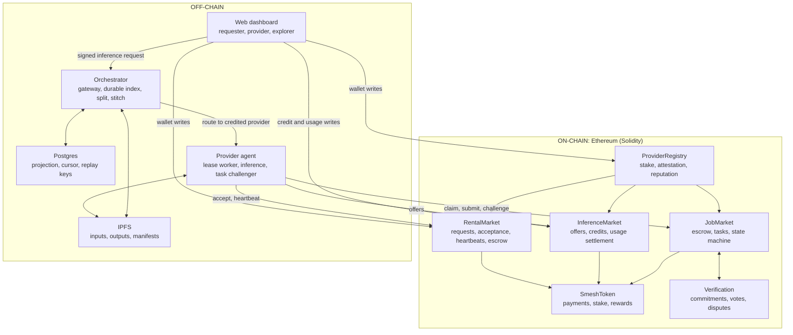
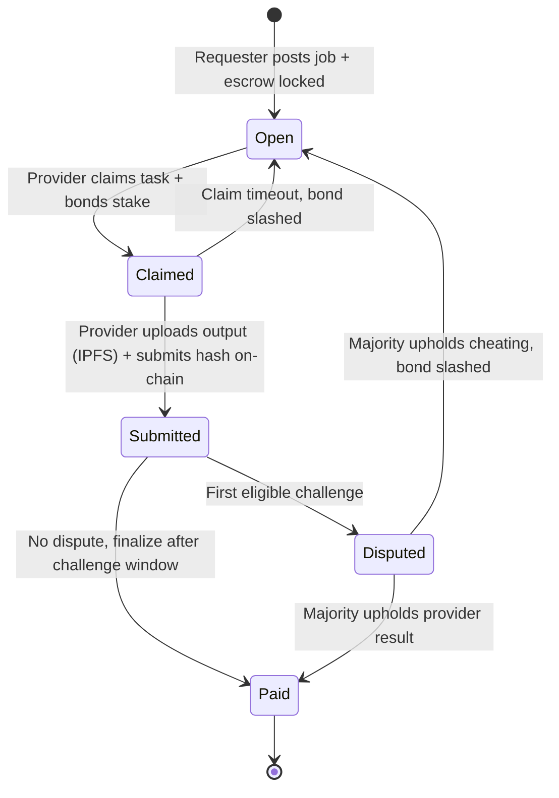
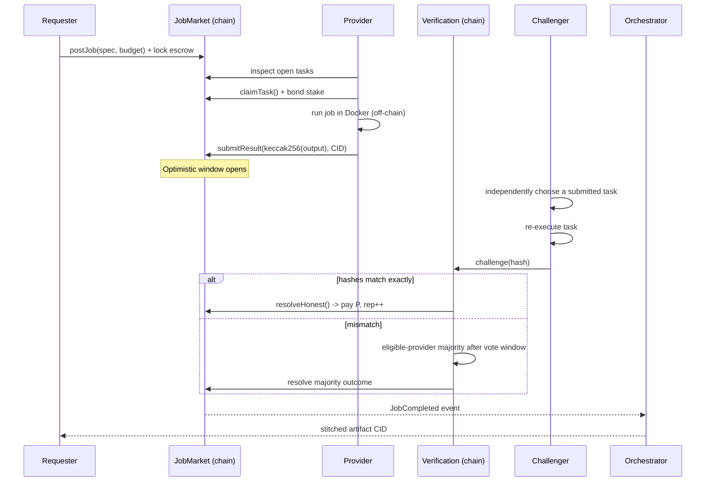

# ShaderMesh: Review 1 Proposal and Design

> A decentralized marketplace for renting compute on Ethereum, focused on managed inference and provider-approved GPU-capable leases, with a retained verifiable-task mode.

**Course:** Blockchain / Cryptocurrency
**Review:** Review 1 (Proposal and Design), 09-09-26 to 16-09-26

> Implementation update (17 September 2026): the dual-market prototype, CI, and
> Sepolia deployment are operational. Rental, managed inference, and deterministic-task
> flows were validated on an RTX 4070 Laptop provider. The authoritative current status
> and requirement traceability live in `docs/ShaderMesh-SRS.md`.

---

## 1. Project Title

**ShaderMesh: A Decentralized Marketplace for Renting Compute (LLM and AI first)**

*Subtitle: staking, uptime and attestation, reputation, and slashing secure rented compute; an optimistic re-execution game secures deterministic tasks. One coordination layer, two market modes.*

---

## 2. Team Members & Roll Numbers

| # | Name | Roll Number | Primary Responsibility |
|---|------|-------------|------------------------|
| 1 | _[Fill in]_ | _[Fill in]_ | Smart contracts (Solidity) & tokenomics |
| 2 | _[Fill in]_ | _[Fill in]_ | Provider compute agent & orchestrator |
| 3 | _[Fill in]_ | _[Fill in]_ | Web dashboard & verification/analytics |

> Replace the placeholders with your actual team roster before submission.

---

## 3. Problem Statement

### What problem is being addressed?

Demand for GPU compute, led by AI and large language models, is rising far faster than accessible supply. Capacity is concentrated in a few centralized clouds, while millions of capable GPUs sit idle in homes, studios, and labs. This creates four concrete problems:

1. **Scarce and expensive AI compute.** GPU rental for running and fine-tuning models is costly and often waitlisted, and prices are set by a small number of providers.
2. **Idle supply cannot be safely monetized.** An individual with a few GPUs cannot easily rent them to strangers, because payment, metering, uptime enforcement, and disputes are unsolved without a trusted intermediary that takes a large cut.
3. **Centralized trust and lock-in.** Renters depend on one company for availability, honest billing, and access, with no neutral guarantee and limited portability.
4. **No neutral settlement for a rental agreement.** Renting compute is a service agreement over time. Enforcing uptime, proving the advertised hardware, streaming payment, and refunding downtime require a neutral, automatic settlement layer.

### Why is blockchain and cryptocurrency relevant?

A rental marketplace between mutually distrusting parties needs a neutral settlement and coordination layer. Blockchain provides these mechanisms:

- **Escrow with streamed settlement.** A contract holds the renter's funds and releases them for completed intervals backed by provider heartbeats, then refunds unused time.
- **Staking and slashing.** Providers post collateral that is slashed for missed-heartbeat termination and, from free stake only, for failed or missed benchmark challenges.
- **On-chain reputation.** A public record of protocol outcomes that no single marketplace database controls.
- **Utility-token payments.** Per-interval and per-request settlement without banks or chargebacks.
- **Transparent, auditable rules.** Pricing, leasing, attestation, and dispute logic live in open contracts.

Because a rented result (an LLM response, a training run) cannot be re-executed and checked, trust is availability based: uptime heartbeats, hardware attestation, reputation, and slashing. For deterministic jobs with a checkable output (rendering, batch), the marketplace retains an optimistic re-execution game. The blockchain is never used to do the compute; it is the trust, coordination, and payment layer around off-chain compute.

---

## 4. Objectives

1. **Design a decentralized compute-rental marketplace** on Ethereum with on-chain listings, leases, streamed escrow, provider staking, and settlement via smart contracts.
2. **Secure rented compute without result verification** using staking, signed uptime heartbeats, hardware attestation or benchmark challenges, reputation, and slashing for SLA breaches.
3. **Specialize in LLM and AI compute** by offering a managed, provider-served, OpenAI-compatible inference endpoint and raw GPU leases for running or fine-tuning models, while generalizing to any containerized workload.
4. **Retain a verifiable-task mode** for deterministic jobs (rendering, batch) using an optimistic re-execution game (staking, reputation, randomized spot-checking, slashing), reusing the same staking and reputation layer.
5. **Deliver a live 2 to 3 node prototype** (lease a GPU, serve an LLM through the gateway, stream payment, and run a verifiable job) plus a simulator, and **evaluate** deterrence, cost, attacker resistance, and gas.

---

## 5. Motivation / Need for the Project

- **Economic:** Independent owners may have idle GPU capacity while requesters face limited or expensive supply. A marketplace can coordinate that supply without a custodial billing operator.
- **Technical:** Verifiable outsourced computation remains an active research problem. The project implements practical escrow and availability controls while retaining an optimistic task-verification path.
- **Educational:** The project covers ERC-20 tokens, escrow, staking and slashing, on-chain state machines, event-driven agents, dispute resolution, and mechanism design.
- **Practical:** Rental, inference, and deterministic task flows provide observable outputs for evaluation.

---

## 6. Literature Survey

> Minimum 5 to 10 relevant works, their approach, and the gap ShaderMesh addresses.

| # | Work | Approach | Limitation / Gap |
|---|------|----------|------------------|
| 1 | **Nakamoto (2008), _Bitcoin_** | PoW ledger; trustless value transfer between strangers. | No general computation; no marketplace for compute. |
| 2 | **Buterin (2014) / Wood, _Ethereum White/Yellow Paper_** | Turing-complete smart contracts enabling escrow, tokens, staking. | On-chain compute is far too expensive for real workloads; needs an off-chain execution layer. |
| 3 | **Golem (2016) Whitepaper** | Ethereum-based P2P compute market; began with Blender rendering. | Verification largely trust/redundancy based; complex UX; generalization and robust verification remained weak. |
| 4 | **Render Network (OTOY) Whitepaper** | Marketplace specifically for GPU 3D rendering (Octane). | Rendering-only; verification leans on reputation/manual review; relatively centralized coordination. |
| 5 | **Akash Network Docs/Whitepaper** | Decentralized cloud (Docker/K8s) via reverse-auction; Cosmos-based. | Focus on *availability/liveness*, not *correctness verification* of results; SDL/K8s complexity. |
| 6 | **Truebit, Teutsch and Reitwießner (2017)** | Interactive **verification game** (challenger + on-chain bisection referee) for scalable off-chain compute. | Complex multi-round on-chain disputes; high implementation cost; not tailored to rendering. |
| 7 | **Livepeer, Petkanics and Tang (2018)** | Decentralized video transcoding with **probabilistic (spot-check) verification** + staking. | Domain-specific to transcoding; ShaderMesh generalizes the spot-check + reputation idea. |
| 8 | **iExec, Fedak et al. (2018)** | Decentralized cloud using **TEE (Intel SGX) attestation** for trust. | Hardware-dependent (SGX); trusted-hardware assumptions; not commodity-GPU friendly. |
| 9 | **Filecoin, Protocol Labs (2017)** | Marketplace for *storage* with Proof-of-Replication / Proof-of-Spacetime. | Solves verifiable *storage*, not verifiable *computation*; useful as a design analogue. |
| 10 | **Bittensor, Rao et al. (2021)** | Decentralized ML network with "proof of intelligence" peer scoring. | Verification is subjective/peer-ranked; specific to ML; not deterministic-result checking. |
| 11 | **Arbitrum, Kalodner et al. (2018, USENIX Security)** | **Optimistic** execution: assume honest, allow a challenge window, dispute only if contested. | Designed for L2 transactions, not compute jobs; ShaderMesh borrows the optimistic + challenge-window pattern. |
| 12 | **OpenZeppelin Contracts (tooling)** | Audited, reusable ERC-20 / access-control / security primitives. | A building block, not a solution; we compose these into the marketplace. |

**Synthesis of the gap:** Existing systems are often domain-specific, use complex
verification, depend on trusted hardware, or focus on liveness rather than result
correctness. ShaderMesh separates availability-secured rentals from deterministic tasks.
The current prototype implements escrow, stake, attestation records with recurring benchmark
challenges, strict heartbeat settlement, and simple eligible-provider task disputes. Random selection, reputation
weighting, SSIM, and distributed GPU rendering remain planned.

---

## 7. Existing System

### Current methods

- **Centralized cloud GPU (AWS/GCP/Azure, CoreWeave, Lambda):** rent GPUs by the hour from one company.
- **Centralized render farms (SaaS):** upload a scene, they render it on their farm.
- **First-gen decentralized networks (Golem, Render, Akash):** P2P marketplaces with token payments.

### Problems / limitations

| Dimension | Centralized cloud / render farm | First-gen decentralized |
|-----------|-------------------------------|-------------------------|
| Trust | Single company; opaque billing; possible censorship. | Better, but often weak/optional result verification. |
| Price | Oligopoly list pricing; no supply-side competition from individuals. | Improving, but liquidity and UX are hard. |
| Supply | Individuals can't easily sell idle GPUs. | Onboarding & metering complexity. |
| Correctness proof | None; you trust the invoice. | Redundancy or reputation only; collusion-prone or expensive. |
| Payment | Bank/card, chargebacks, KYC friction. | Token payments, but volatile UX. |

---

## 8. Proposed System

### Solution

**ShaderMesh** is a blockchain-coordinated marketplace with two modes over one staking, reputation, and slashing layer.

**Rental mode (primary), for renting compute including LLMs:**

1. A **Provider** registers, stakes, receives a trusted attester record, and lists capacity with a price per interval. The attester then issues recurring benchmark challenges; a failed or missed challenge slashes free stake to a treasury and revokes the attestation.
2. A **Requester** submits a funded lease request bound to a content-addressed manifest. It remains pending until the provider accepts or rejects it; the requester may also cancel it.
3. Acceptance starts the lease clock, reserves the listing, and bonds provider stake. The current agent accepts only its configured manifest and launches only provider-configured workload settings.
4. The provider posts one direct signed transaction for each current interval. A missed interval cannot be heartbeated later. Settlement pays only completed intervals in the contiguous heartbeat prefix. Downtime permits termination, refund, and slashing.
5. For managed inference, a provider publishes a model offer and a requester opens prepaid credit. The requester signs each gateway request and submits cumulative token counters on chain. This requester-metered design does not independently prevent under-reporting.

**Verifiable-task mode (retained), for deterministic jobs such as rendering:**

1. A requester posts a job and locks escrow; a thin orchestrator splits it into tasks.
2. Staked providers claim tasks, execute off chain in Docker, store outputs on IPFS, and submit a result commitment.
3. Eligible challengers may re-execute submitted tasks and vote with plaintext result hashes. A majority with the configured disagreement quorum can slash and reopen a task. Random selection, reputation weighting, and commit-reveal remain planned.

### Advantages

- **Fits the actual trust model.** Rented compute is secured by availability and attestation, not by pretending an LLM result can be re-verified.
- **LLM and AI focused, with a general protocol model.** Managed inference and provider-approved GPU-capable leases cover the current prototype without claiming arbitrary workload execution.
- **Contract-controlled settlement.** Streamed escrow protects the renter from recorded downtime; staking and slashing create consequences for missed heartbeats.
- **Scoped verification.** Deterministic jobs use challenge-based re-execution while rental workloads use availability evidence.
- **Open provider registration.** A provider can register and stake, then requires the configured attester before publishing listings or offers.
- **Transparent and auditable.** Listings, leasing, attestation, and dispute logic live in open contracts.

---

## 9. Blockchain Concepts Used

- **Blockchain type:** **Public** (Ethereum, with a local Hardhat devnet for development and a source-verified Sepolia deployment). The contracts are portable to an EVM L2 as future work.
- **Consensus mechanism:** We **inherit Ethereum's Proof-of-Stake** for ledger security and do not build a base-layer consensus. Our contribution is application-layer mechanism design: an availability-based rental agreement (streamed escrow, heartbeats, attestation, SLA slashing) and an optimistic re-execution game for deterministic tasks.
- **Smart contracts (Solidity):**
  - `SmeshToken`: ERC-20 utility token for payments, staking, and rewards.
  - `ProviderRegistry`: registration, staking, free-form capabilities, typed GPU attestation records, attester-issued benchmark challenges with free-stake slashing to a treasury, reputation, slashing.
  - `RentalMarket`: pending manifest-bound requests, provider acceptance, listings, leases, strict per-interval heartbeats, streamed escrow, extension, refund, and SLA slashing.
  - `InferenceMarket`: model offers and prepaid requester-metered credits with cumulative settlement and refunds.
  - `JobMarket`: verifiable-task posting, escrow, claiming, state machine, settlement.
  - `Verification`: result commitments, spot-check scheduling, dispute resolution, reward and slash.
- **Cryptocurrency and token:** **SMESH**, an ERC-20 utility token used for compute payment, provider stake, collateral, and rewards. Current cryptographic uses include keccak256 result commitments, transaction signatures, EIP-191 inference authorizations, and IPFS CIDs. Relayed heartbeats and commit-reveal challenges remain planned.

---

## 10. System Architecture / Block Diagram



The diagram reflects the current local and Sepolia implementation. Postgres stores a rebuildable
projection snapshot and exact event cursor, plus durable inference replay keys. It does
not replace the chain as the source of truth.

**Trust boundary:** the orchestrator is deliberately thin and untrusted. It cannot steal funds
or force acceptance of a result, because all value movement and validation happen on chain. The
inference gateway routes and meters requests but custodies no funds; settlement is on chain. If
the orchestrator misbehaves, the worst case is degraded liveness, not loss of funds.

---

## 11. Modules

1. **Token (`SmeshToken`)**: ERC-20 for payments, staking, and rewards, with a testnet faucet.
2. **Identity, staking, attestation (`ProviderRegistry`)**: registration, free-form capabilities, stake, typed GPU attestation records, eligibility, an EMA reputation over outcomes, and restricted slashing hooks. Seeded benchmark challenges (a 500,000-iteration SHA-256 hash chain plus a score) are answered by the provider and judged by the attester; a wrong answer or a missed deadline slashes up to 10 SMESH of free stake to the treasury, revokes the attestation, and lowers reputation. The attester remains a trusted judge, and a benchmark proves responsiveness, key control, and throughput rather than the exact GPU model.
3. **Rental market (`RentalMarket`)**: listings, pending manifest-bound requests, provider acceptance or rejection, requester cancellation, acceptance-time bonds, strict current-interval heartbeats, streamed escrow, extension, refund, and SLA slashing.
4. **Inference market (`InferenceMarket`)**: provider model offers and prepaid credits tied to a requester, provider, model, and snapshotted price. Only the requester can submit monotonic cumulative usage or close the credit.
5. **Verifiable-task market (`JobMarket`)**: job posting with escrow, task metadata, claiming, the task state machine, and settlement.
6. **Verification and dispute (`Verification`)**: plaintext result-hash votes, dispute resolution, quorum, reward, and slash. Commit-reveal, random reputation-weighted selection, and SSIM remain planned.
7. **Provider node agent (off-chain, Python)**: accepts allowlisted manifests, launches provider-configured constrained lease workloads, sends direct heartbeat transactions, maintains model offers, serves an OpenAI-compatible endpoint, executes task jobs, samples challenger work, discovers host hardware, and retries transient RPC and IPFS operations.
8. **Orchestrator (off-chain, TypeScript)**: persists and replays a chain projection in Postgres; exposes APIs and event history; validates signed inference requests and durable replay keys; routes only to the credited provider; and splits and stitches jobs. It custodies no funds and does not settle usage.
9. **Storage (IPFS)**: content-addressed storage for inputs, outputs, and manifests. The chain stores CIDs plus compact market metadata and accounting.
10. **Web application (off-chain, Next.js + viem)**: a landing page, rental requests and management, prepaid inference, a provider operations console with challenge history, and a read-only explorer with a Challenges tab and event timeline, on a light-first editorial design system with a dark theme (`web/DESIGN.md`). Verifiable-job submission and live tile assembly remain planned.
11. **Simulator**: models task verification and rental economics across honest, lazy, malicious, and colluding populations, including false-heartbeat detection and escrow conservation.

---

## 12. Technology Stack

| Layer | Choice | Why |
|-------|--------|-----|
| **Blockchain platform** | Ethereum, Hardhat local devnet, Sepolia deployed | EVM settlement with a reproducible local target and public testnet validation. |
| **Smart-contract language** | Solidity 0.8.x + OpenZeppelin | Standard primitives including ERC-20, Ownable, SafeERC20, and ReentrancyGuard. |
| **Contract tooling / tests** | Hardhat, TypeScript, Chai | Compile, deploy, unit and lifecycle tests, and gas reporting. |
| **Provider agent** | Python 3.11, `web3.py`, Docker SDK | Chain transactions, lease and task workers, heartbeats, and hardware discovery. |
| **LLM inference runtime** | Deterministic echo backend and Ollama | Reproducible local testing plus validated `qwen3:0.6b` serving on Sepolia. |
| **Orchestrator / gateway** | Node.js + TypeScript, `ethers`, IPFS client | Event indexing, split and stitch, OpenAI-compatible gateway with metering. |
| **Frontend** | Next.js + React + TypeScript + `viem` + Tailwind | EIP-1193 wallet writes and indexed reads. |
| **Storage** | IPFS Kubo and local test storage | Content-addressed inputs and outputs; on chain stores only CIDs. |
| **Compute runtime** | Docker with optional NVIDIA Container Toolkit | Constrained lease and task execution. Blender remains planned. |
| **Attestation** | Attester record, seeded benchmark challenges, and direct provider heartbeat transactions | Current prototype gate. The attester judges challenges. Relayed heartbeats remain planned. |
| **Datastore / indexer** | PostgreSQL with `pg` | Durable projection snapshots, exact event cursors, and inference replay keys. |
| **Dev infra** | Docker Compose and GitHub Actions | Local stack, provider-only Windows node, deployed Sepolia operator stack, and CI. |
| **Optional (Rust/Go)** | A high-performance provider agent variant | Leverages team Rust/Go skill; stretch goal. |

---

## 13. Methodology / Workflow

### Job lifecycle (state machine)



### Lease lifecycle (rental, primary)

```mermaid
stateDiagram-v2
    [*] --> Listed: Provider lists capacity and passes attestation
    Listed --> Pending: Requester funds request with manifest
    Pending --> Active: Provider accepts; clock and bond start
    Pending --> Rejected: Provider rejects and escrow is refunded
    Pending --> Cancelled: Requester cancels and escrow is refunded
    Active --> Active: Current interval heartbeat; completed prefix settles
    Active --> Ended: Requester ends or duration elapses, unused escrow refunded
    Active --> Terminated: Current interval missed beyond grace
    Terminated --> Slashed: Provider slashed for SLA breach, requester refunded
    Ended --> [*]
    Rejected --> [*]
    Cancelled --> [*]
    Slashed --> [*]
```



### Verification game (sequence)



### Development methodology

Agile and iterative, contract first:
1. Model and specify the economic rules and state machines (lease and task).
2. Contracts and tests first, using Hardhat unit and lifecycle tests for escrow, streaming, staking, and slashing. Property fuzzing remains planned.
3. Provider agent against a local devnet: accepted rental serving with strict heartbeats, inference offers, task worker and challenger, hardware discovery, and bounded retry.
4. Integrate the orchestrator (signed gateway, Postgres projection and replay) plus IPFS and the dashboard.
5. Adversarial testing via the simulator (downtime and SLA breaches for rentals; lazy, false-result, and collusion for tasks).
6. Deploy the operator and provider stacks to Sepolia, then record rental, inference, and task validation.

### The verifiability nuance (design depth)

GPU rendering can be **non-deterministic** across different GPUs (floating-point differences), so naive exact-hash comparison can false-positive as "cheating." Our mitigations:
- **Pin the environment:** identical Docker image, Blender version, seed, and render settings.
- **Deterministic mode** for verifiable tasks (fixed tile size, CPU or deterministic GPU path).
- **Tolerant comparison:** compare via **perceptual hash / SSIM** above a threshold rather than exact bytes for GPU outputs; reserve exact keccak256 for deterministic containers.
This nuance is a first-class part of the "verification policy" attached to each job type.

---

## 14. Dataset / Input Details

This is a compute marketplace rather than an ML dataset project, but we standardize a small suite for reproducible demos and evaluation:

- **LLM inference inputs:** the local demo uses deterministic echo responses. Sepolia validation used the OpenAI-compatible gateway with a real `qwen3:0.6b` Ollama provider.
- **Rental workloads:** the local demo uses a provider-approved CPU placeholder. Sepolia validation used an immutable NVIDIA CUDA image on an RTX 4070 Laptop GPU.
- **Rendering inputs (verifiable task):** the current fixture is a deterministic Mandelbrot tile job. Blender scenes and perceptual verification are future work.
- **Adversarial inputs (simulator):** scripted provider behaviors: for rentals, downtime and false hardware claims; for tasks, lazy, false-result, and colluding behavior.

The live stack supports IPFS for job inputs, outputs, and manifests; tests may use local
content-addressed storage. The chain stores CIDs plus compact listing, lease, provider,
inference, accounting, and heartbeat state.

---

## 15. Current Outcomes and Remaining Scope

Implemented and validated:

1. Six-contract suite: token, registry, rental, inference, job, and verification.
2. Pending manifest-bound lease requests with provider acceptance, strict interval
   heartbeats, streamed settlement, refund, and downtime slashing.
3. Prepaid requester-metered inference credits, EIP-191 gateway authorization,
   provider-pinned routing, replay protection, and on-chain cumulative settlement.
4. Constrained lease and task workers, challenger sampling, bounded retries, hardware
   discovery, and idempotent provider listing and offer maintenance.
5. Durable Postgres projection and replay, requester and provider flows, provider
   console, explorer, a landing page, and a seeded one-command Compose stack.
   Benchmark challenges run automatically in the local stack through an attester service.
6. An expanded simulator for heterogeneous task verification and rental uptime,
   false-heartbeat detection, payments, refunds, slashing, and escrow conservation.
7. A source-verified Sepolia deployment with an attested RTX 4070 provider, real
   Ollama inference, a GPU lease, and two settled deterministic jobs.

Still planned:

1. Decentralized benchmark judging (the attester is currently a trusted role) and multi-provider evaluation.
2. Provider-signed inference usage or a dispute mechanism for requester under-reporting.
3. Commit-reveal, reputation-weighted random challenger selection, and SSIM verification.
4. Verifiable-job submission and live tile assembly in the dashboard, final evaluation,
   and recorded delivery materials.

---

## 16. Project Timeline / Work Plan

The authoritative roadmap and per-requirement status are in
`docs/ShaderMesh-SRS.md` sections 11 and 12.

| Workstream | Status |
|------------|--------|
| Core token, registry, job, and verification contracts | done, except planned verification hardening |
| Rental and inference contracts | done for the requester-metered prototype |
| Provider task worker, challenger, lease service, inference, and hardening | done |
| Orchestrator split, stitch, durable projection, APIs, and signed gateway | done |
| Landing, rental, inference, provider, and explorer web surfaces | done; verifiable-job submission remains planned |
| Verification and rental simulator | done; final evaluation remains planned |
| CI and local full-stack checks | done for current suites |
| Sepolia operator and Windows provider tooling | deployed and validated on one provider |
| Benchmark challenges with free-stake slashing | done; live on Sepolia |
| Commit-reveal, random selection, SSIM, and Blender rendering | planned; rendering is descoped to future work |

### Current verification

| Suite | Count |
|-------|------:|
| Hardhat contracts | 42 passing |
| pytest provider agent | 58 passing |
| Vitest orchestrator with Postgres | 54 passing |
| unittest simulator | 15 passing |
| Playwright web app, desktop and mobile, including wallet-write flows | 24 passing |

GitHub Actions compiles and tests contracts, emits the gas report, runs agent and
simulator tests, runs orchestrator tests against Postgres and type checking, and runs
web lint, type checking, and production build. A dependent full-stack job starts Compose,
runs the signed prepaid-inference smoke flow, and runs Playwright.

### Operator commands

Local seeded stack:

```powershell
Copy-Item .env.example .env
docker compose up --build -d
docker compose ps --all
```

Windows provider-only node:

```powershell
python .\agent\discover_hardware.py
Copy-Item .\agent\.env.example .\agent\.env
docker compose --env-file .\agent\.env -f .\docker-compose.provider.yml config --quiet
docker compose --env-file .\agent\.env -f .\docker-compose.provider.yml up --build -d
```

Sepolia operator, after setting untracked `contracts/.env` and root `.env`:

```powershell
cd .\contracts
npm ci
npm run compile
npm run deploy:sepolia
cd ..
docker compose -f .\docker-compose.sepolia.yml config --quiet
docker compose -f .\docker-compose.sepolia.yml up --build -d
```

Providers self-register before the operator sets `BOOTSTRAP_PROVIDERS_JSON` and optional
`BOOTSTRAP_REQUESTER_JSON` in `contracts/.env` and runs `npm run bootstrap:sepolia` from
`contracts/`. Funding targets and matching fresh attestations are idempotent.

---

## 17. References

1. S. Nakamoto, "Bitcoin: A Peer-to-Peer Electronic Cash System," 2008.
2. V. Buterin, "Ethereum: A Next-Generation Smart Contract and Decentralized Application Platform" (White Paper), 2014.
3. G. Wood, "Ethereum: A Secure Decentralised Generalised Transaction Ledger" (Yellow Paper), 2014.
4. The Golem Project, "The Golem Whitepaper," 2016.
5. J. Benet et al. / Protocol Labs, "Filecoin: A Decentralized Storage Network," 2017.
6. J. Teutsch and C. Reitwießner, "A Scalable Verification Solution for Blockchains" (TrueBit), 2017.
7. D. Petkanics and E. Tang, "Livepeer Whitepaper: Protocol and Economic Incentives For a Decentralized Live Video Streaming Network," 2018.
8. G. Fedak et al., "iExec Whitepaper: Blockchain-Based Decentralized Cloud Computing," 2018.
9. OTOY / Render Network, "The Render Network Whitepaper."
10. Overclock Labs, "Akash Network: Decentralized Compute Marketplace" (documentation/whitepaper).
11. Y. Rao et al., "Bittensor: A Peer-to-Peer Intelligence Market," 2021.
12. H. Kalodner et al., "Arbitrum: Scalable, Private Smart Contracts," USENIX Security Symposium, 2018.
13. OpenZeppelin, "OpenZeppelin Contracts, Secure Smart Contract Library" (documentation).
14. io.net, "A Decentralized Network for GPU Compute" (documentation), 2024.
15. W. Kwon et al., "Efficient Memory Management for Large Language Model Serving with PagedAttention" (vLLM), SOSP, 2023.
16. Vast.ai, "Decentralized GPU Rental Marketplace" (documentation).

---

## Review 1 Deliverables: Checklist

- [x] **Problem statement and objectives** (sections 3 and 4)
- [x] **Literature survey** (section 6)
- [x] **Architecture and design** (section 10 block diagram, section 11 modules)
- [x] **Methodology** (section 13: lease and task lifecycles, verification game, dev process)
- [x] **Technology stack** (section 12)
- [x] **Project report and documentation** (this document and `docs/ShaderMesh-SRS.md`)
- [x] **Current prototype** (six contracts, agent, durable orchestrator, dashboard, simulator, Compose, and CI)
- [x] **Presentation assets** exist; the editable DOCX, presentation guide, PNG figures, and figure generator are retained. Superseded generated outputs were removed.

> Current direction: compute rental with an LLM focus and a retained verifiable-task mode.
> Sepolia is deployed and validated on one physical provider. The authoritative roadmap and
> requirement status are `docs/ShaderMesh-SRS.md` sections 11 and 12.
