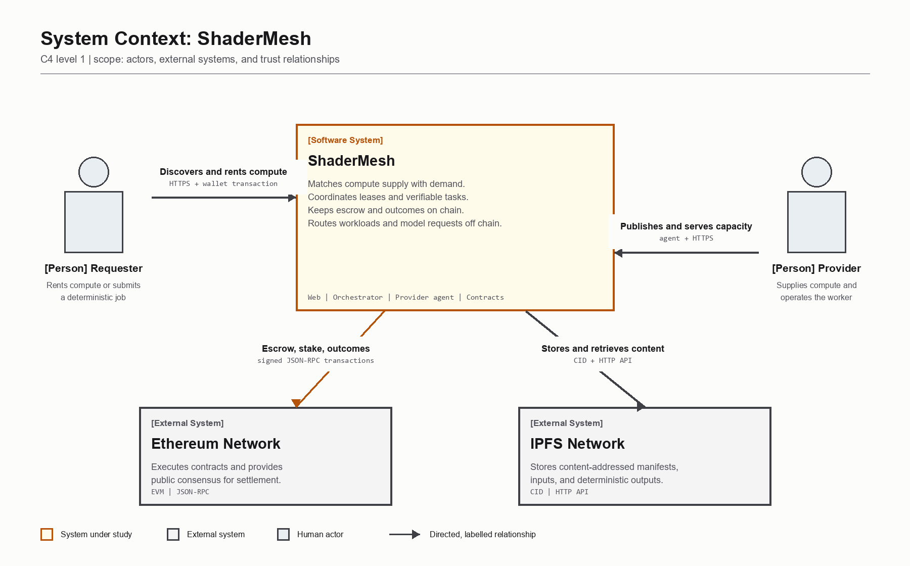
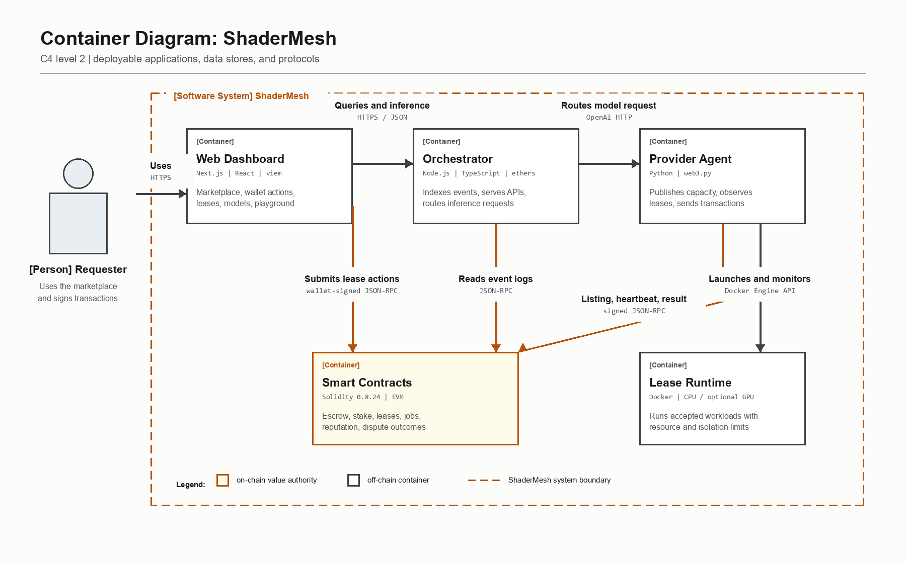
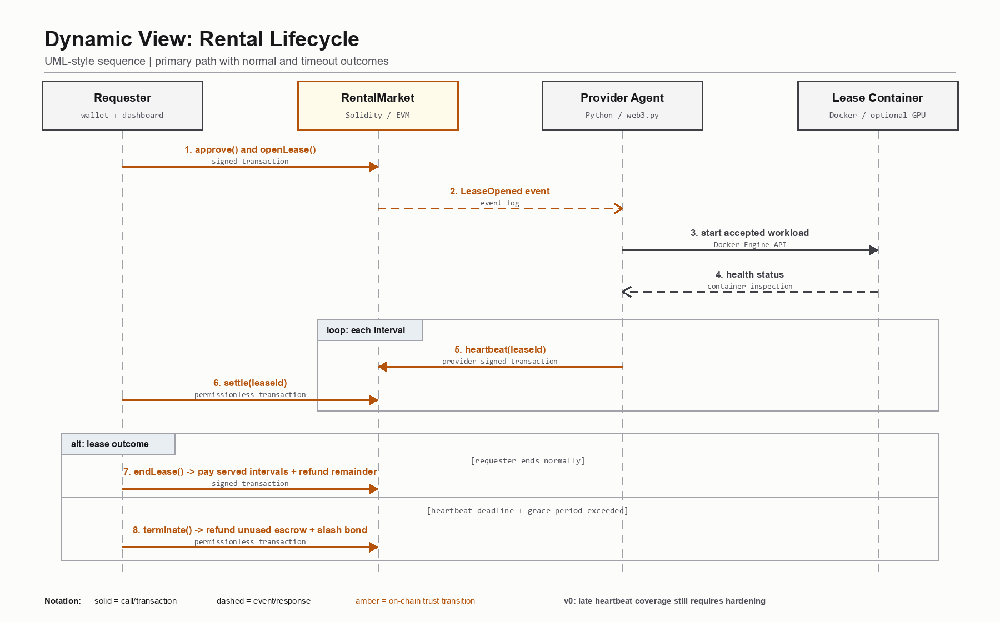
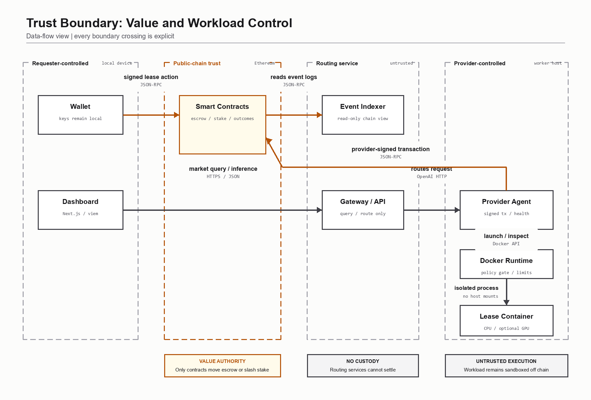

# SHADERMESH

## A Decentralized Marketplace for Renting Compute

### Project Review 1: Proposal and Design Report

**Submitted to:** 
`[INSTITUTION NAME]` 
`[DEPARTMENT NAME]` 
`[DEGREE / PROGRAM NAME]`

**Course:** `[COURSE CODE AND COURSE TITLE]` 
**Faculty Guide:** `[FACULTY GUIDE NAME AND DESIGNATION]`

**Submitted by:**

| Student Name | Roll Number |
|---|---|
| `[STUDENT NAME 1]` | `[ROLL NUMBER 1]` |
| `[STUDENT NAME 2]` | `[ROLL NUMBER 2]` |
| `[STUDENT NAME 3]` | `[ROLL NUMBER 3]` |

**Academic Year:** `[2026-2027]` 
**Submission Date:** `[DD MONTH YYYY]`

---

## Abstract

Graphics processing unit capacity is increasingly required for large language model
inference, fine-tuning, rendering, simulation, and other parallel workloads. Access to
this capacity is concentrated in centralized cloud platforms, while useful hardware in
personal workstations, laboratories, and small organizations can remain underutilized.
Direct rental between independent owners and requesters is difficult because both parties
need guarantees concerning payment, availability, advertised hardware, and service failure.

ShaderMesh is proposed as a decentralized marketplace for renting containerized compute.
Ethereum acts as the trust, coordination, and settlement layer, while the actual computation
runs off chain on provider machines. Providers register, stake a utility token, publish
hardware listings, and receive an attestation record. Requesters open time-based leases and
fund smart-contract escrow. The intended rental policy releases escrow only for intervals with
timely availability evidence; a missed deadline permits termination, refund, and slashing. Managed
large language model inference is exposed through an OpenAI-compatible gateway. A separate
verifiable-task design uses result commitments, re-execution, disputes, and slashing.

The initial prototype includes Solidity contracts, a Python provider agent, constrained Docker
execution, a TypeScript event indexer and inference gateway, a Next.js dashboard, and a local
Docker Compose environment. The current implementation demonstrates real local-chain
transactions and lease-bound containers, while hardware identities and model responses remain
controlled demo inputs. The proposed next stage is a multi-laptop deployment using NVIDIA
hardware and Sepolia, with accepted workload manifests, timely per-interval availability
evidence, and randomized commit-reveal verification. The current prototype uses the latest
provider heartbeat for settlement and voluntary plaintext challenge votes; these mechanisms
validate the state machines but are not yet production-grade trust guarantees.

**Keywords:** decentralized compute, GPU rental, Ethereum, smart contracts, escrow, staking,
slashing, LLM inference, Docker, optimistic verification

## Table of Contents

1. Introduction
2. Objectives and Motivation
3. Literature Survey
4. Existing System and Identified Gap
5. Proposed System
6. Blockchain Design
7. System Architecture and Modules
8. Methodology and Workflow
9. Technology Stack
10. Initial Prototype and Current Status
11. Input Details and Evaluation Plan
12. Expected Outcomes
13. Project Timeline
14. Risks, Limitations, and Ethical Considerations
15. Conclusion
16. References

## Abbreviations

| Term | Meaning |
|---|---|
| API | Application Programming Interface |
| CID | Content Identifier |
| EVM | Ethereum Virtual Machine |
| GPU | Graphics Processing Unit |
| IPFS | InterPlanetary File System |
| LLM | Large Language Model |
| PoS | Proof of Stake |
| RPC | Remote Procedure Call |
| SLA | Service Level Agreement |
| TEE | Trusted Execution Environment |

## 1. Introduction

### 1.1 Background

Modern artificial intelligence systems depend heavily on parallel compute. LLM inference,
model fine-tuning, image generation, scientific simulation, and rendering all benefit from
GPUs. Centralized cloud providers make this hardware available, but access is governed by a
single operator, fixed platform policies, and centrally administered billing. At the same
time, capable GPUs in gaming computers, workstations, laboratories, and small data centers may
remain idle for significant periods.

A peer-to-peer compute market could connect this unused supply with requesters. However, the
market participants may not know or trust each other. A requester needs confidence that the
advertised hardware exists, the service remains available, and unused funds can be recovered.
A provider needs confidence that completed service will be paid. A neutral mechanism is also
needed to record reputation and apply penalties when an agreed SLA is violated.

### 1.2 Problem Statement

The problem addressed by ShaderMesh is the absence of a transparent and programmable settlement
layer for renting independently owned compute. Existing centralized marketplaces can match
supply and demand, but they control account approval, billing, service records, and dispute
outcomes. Fully decentralized designs face a second problem: arbitrary computation is expensive
to reproduce and cannot generally be verified on chain. Interactive workloads such as an LLM
session are also non-deterministic and time-sensitive.

ShaderMesh therefore separates computation from settlement and distinguishes between two types
of trust. A time-based rental is secured through availability evidence, attestation, provider
stake, reputation, and SLA penalties. A deterministic task is secured through result commitments
and optimistic re-execution. The project does not claim that every computation can be proven
correct. It selects a trust model according to the type of workload.

### 1.3 Relevance of Blockchain and Cryptocurrency

Blockchain is relevant because the parties require shared economic state without appointing one
of them as the trusted administrator. Smart contracts can hold prepaid funds, bond provider
stake, apply a public state machine, and release or refund funds according to deterministic
rules. Transactions provide an auditable record of listings, leases, heartbeats, settlement,
reputation updates, and slashing.

The blockchain does not execute GPU workloads. Repeating such computation across Ethereum
validators would be prohibitively expensive and unnecessary. Ethereum is used only for the
parts that require consensus. Provider agents, inference servers, storage, and indexing remain
off chain. The SMESH token is a prototype utility token for escrow, stake, and rewards. It is
not presented as an investment asset.

### 1.4 Scope

The primary scope is time-based rental of GPU or CPU capacity, including managed LLM inference.
The retained secondary scope is deterministic task execution, such as rendering or batch work,
where sampled re-execution is meaningful. The initial prototype targets a local Ethereum devnet
and a small network of provider machines. Sepolia deployment is the next public test stage.

## 2. Objectives and Motivation

### 2.1 Objectives

1. Design and implement an Ethereum-based compute marketplace with provider listings,
   time-based leases, escrow, interval settlement, refunds, and SLA termination.
2. Create a provider security model based on staking, hardware attestation, signed availability
   reports, public reputation, and slashing for defined failures.
3. Support AI workloads through a provider-hosted OpenAI-compatible inference endpoint and a
   path toward raw GPU container rental.
4. Retain a verifiable-task mode for deterministic workloads using commitments, re-execution,
   disputes, and economic penalties, then harden it with randomized challenger selection.
5. Deliver and evaluate a reproducible multi-component prototype with smart-contract tests,
   constrained workload execution, APIs, a dashboard, and a multi-laptop test plan.

### 2.2 Motivation and Need

The project is motivated by three practical needs. First, smaller users need more flexible
access to compute than conventional cloud purchasing models always provide. Second, independent
hardware owners need a way to monetize spare capacity without relying entirely on a marketplace
operator's private ledger. Third, a blockchain course project should demonstrate why distributed
consensus is useful rather than placing ordinary application data on chain without justification.

ShaderMesh exercises token accounting, escrow, staking, access control, event-driven services,
reputation, state machines, and adversarial incentives. It also exposes the limitations of
blockchain honestly: contracts can enforce economic rules, but they cannot directly observe a
GPU or determine whether a subjective LLM response is correct.

## 3. Literature Survey

The survey uses primary papers where available and official project documentation for systems
whose current operation has changed after their original publications. Sources were accessed on
16 September 2026.

| Work | Existing approach | Limitation or gap relevant to ShaderMesh |
|---|---|---|
| Ethereum, Buterin (2014) [1] | General smart contracts encode shared state transitions, tokens, and escrow. | Replicated EVM computation is unsuitable for bulk GPU workloads, so execution must remain off chain. |
| Golem [2] | Matches requester demands with provider offers and executes work in VM or WASM environments with usage payments. | Payment and execution workflows do not by themselves provide a single general solution for hardware attestation, rental SLA enforcement, and deterministic-result disputes. |
| Truebit, Teutsch and Reitwiessner (2019) [3] | Uses an interactive verification game to reduce a disputed computation to a small step that can be checked on chain. | It requires reproducible computation and active verifiers, so it does not prove availability or quality for interactive GPU leases. |
| Livepeer, Petkanics and Tang (2017) [4] | The whitepaper proposes staking, signed work receipts, and probabilistic verification for decentralized video transcoding. | Its proposed verification and workflow are specialized for video; re-execution also adds significant cost. |
| iExec Proof-of-Contribution [5] | Coordinates off-chain computing with on-chain payment and current TEE-backed attestation. | Security depends on a trusted hardware and attestation stack rather than hardware-independent verification. |
| Akash Network [6] | Provides a decentralized exchange for container-oriented infrastructure using a Cosmos-based network. | Its core design focuses on deployment and resource matching rather than deterministic result adjudication. |
| Render Network [7] | Pools GPU capacity for rendering and extends access through workload-specific compute clients. | General workloads require client-specific integration rather than one uniform rental and verification policy. |
| Filecoin, Protocol Labs (2017) [8] | Uses collateral and proofs to establish storage possession and persistence over time. | Storage proofs do not establish correct execution or interactive service quality, but provide a useful economic analogue. |
| vLLM, Kwon et al. (2023) [9] | Uses PagedAttention and continuous batching for efficient LLM serving through an OpenAI-compatible interface. | It is an inference runtime, not a marketplace, payment, attestation, or dispute system. |
| Vast.ai [10] | Operates a marketplace for community and data-center GPUs with templates, benchmarks, reliability history, SSH, and hosted services. | Trust, verification, billing, and dispute handling remain platform-administered rather than enforced by public smart contracts. |

### 3.1 Survey Synthesis

Prior work establishes the feasibility of programmable settlement, decentralized resource
markets, probabilistic verification, hardware attestation, and optimized inference. ShaderMesh's
defensible design contribution is their integration under two explicit trust models. Non-replayable
rentals use streamed escrow and availability-oriented controls. Deterministic jobs use optimistic
verification. Both use a common staking and reputation layer.

This design does not remove all trust. Heartbeats need independent observation to become strong
availability evidence, hardware attestation depends on the verifier, and sampled checking depends
on independent challengers and suitable comparison rules. These limitations are included in the
prototype roadmap rather than hidden behind a general claim of "verifiable AI."

## 4. Existing System and Identified Gap

### 4.1 Current Methods

The dominant method is centralized cloud rental. A customer selects an instance from a cloud or
GPU marketplace, accepts the operator's account and billing rules, and accesses the machine using
an API, SSH, notebook, or managed service. Community GPU marketplaces widen supply, but platform
servers still perform identity checks, listing verification, billing, and dispute handling.

Decentralized compute systems use different approaches. Some match container deployments through
a blockchain market. Some specialize in rendering or video. Others verify deterministic execution
through replication, challenge games, or trusted hardware. These systems demonstrate useful
components but make different tradeoffs concerning generality, cost, and trust.

### 4.2 Problems and Limitations

- A centralized operator can change prices, suspend accounts, or control dispute outcomes.
- Billing and reliability histories may be held in a private database.
- Replicating every workload is expensive and does not suit interactive services.
- Hardware attestation can introduce a separate trusted authority or specialized hardware.
- Exact output comparison fails for many GPU and LLM workloads.
- Public provider machines create security risks for both renter data and provider hosts.
- Blockchains cannot directly observe off-chain availability without signed reports, probes, or
  trusted measurement services.

### 4.3 Identified Gap

The identified gap is a transparent compute-rental agreement that supports streamed escrow and
SLA penalties while also retaining a distinct verification path for workloads that are actually
checkable. The architecture must keep funds and deterministic rules on chain, keep compute off
chain, and avoid claiming that one verification mechanism applies to every workload.

Figure 1 places ShaderMesh between the two market participants and the external consensus and
storage systems. Each arrow states both the relationship and its protocol.

## 5. Proposed System

### 5.1 Overview

ShaderMesh consists of an Ethereum contract layer, provider agents, an orchestrator, storage, and
a requester-facing web application. Providers stake SMESH and publish listings containing price,
interval, duration limits, region, GPU details, and supported models. A requester selects a
listing and deposits the total lease budget into the RentalMarket contract.

The provider agent observes leases assigned to its address. For a supported workload, it creates
a constrained Docker container and monitors its health. It signs heartbeat transactions while the
service remains active. Settlement releases payment for served intervals. An early end refunds
unused escrow. If the heartbeat deadline and grace period pass, the lease can be terminated and
the provider's bond can be slashed to the renter.

This is the target rental policy. The v0 contract stores only the latest provider heartbeat. A
late heartbeat can therefore extend coverage across earlier silent intervals if termination has
not already been called. Timely per-interval evidence, independent probes, and bounded settlement
are required before this mechanism can provide a strong availability guarantee.

### 5.2 Managed Inference

A provider may advertise models and expose an OpenAI-compatible endpoint. The orchestrator reads
indexed listings, selects a suitable provider, forwards a request, and returns the response with
route and usage information. This interface allows an application to use ShaderMesh similarly to
a conventional model API. Payment-gated per-token settlement and independent health probes remain
future hardening tasks.

### 5.3 Verifiable Tasks

For a deterministic job, the requester posts work and escrow. A provider claims a task and bonds
stake, executes the pinned workload, stores the output, and submits a hash commitment and CID.
The v0 contract allows any eligible provider except the submitter to cast one plaintext hash vote.
After the voting window, a simple majority and configurable quorum determine the outcome; the
default quorum is one. The target design adds randomized challenger selection, commit-reveal,
challenger rewards, and a safer quorum policy. Approximate GPU outputs also require a defined
perceptual comparison policy rather than naive byte equality.

### 5.4 Advantages

- Funds are controlled by contracts rather than the orchestrator or provider agent.
- Streamed settlement is designed to limit renter exposure and pay providers for served intervals.
- Provider collateral creates a direct economic consequence for defined SLA failures.
- Listings, outcomes, and reputation are publicly auditable.
- The compute layer remains general because workloads execute in containers.
- Managed inference uses a familiar API rather than requiring every requester to manage a model.
- Separate rental and task modes avoid false claims about verification of non-deterministic work.

## 6. Blockchain Design

### 6.1 Blockchain Type and Consensus

ShaderMesh uses a public blockchain architecture. Development uses a local Hardhat Ethereum
network, and the intended public prototype uses Sepolia. A later deployment could use an
Ethereum-compatible layer 2 to reduce transaction costs. A private or consortium chain is not
selected because the purpose is neutral settlement among providers and requesters that may not
share an administrator.

The application inherits Ethereum's proof-of-stake consensus. ShaderMesh does not define a new
base-layer consensus algorithm. Its contribution is an application-layer protocol implemented by
smart contracts and off-chain agents.

### 6.2 Smart Contracts

| Contract | Responsibility |
|---|---|
| `SmeshToken` | ERC-20 utility token, local/testnet faucet, payments, stake, and rewards. |
| `ProviderRegistry` | Registration, active status, capabilities, stake, bonded stake, attestation, reputation, and authorized slashing hooks. |
| `RentalMarket` | Listings, lease escrow, provider bonds, heartbeats, interval settlement, extension, end, refund, and SLA termination. |
| `JobMarket` | Deterministic job escrow, task claiming, deadlines, submission, payment, and reassignment. |
| `Verification` | Challenges, result comparison flow, dispute resolution, rewards, and slashing for verifiable tasks. |

The contracts use Solidity 0.8.24 and OpenZeppelin components [11] including ERC-20, ownership,
reentrancy protection, and safe token transfers. Registry economic mutations are limited to
authorized protocol contracts. Off-chain services cannot directly move escrow.

### 6.3 Token Use

SMESH is applicable to the prototype as a utility and test token. It provides one accounting unit
for rental payment, provider stake, lease bonds, and challenge rewards. A testnet faucet reduces
setup friction. The dashboard currently presents a demonstration peg of 1 SMESH to 1 USD. This is
not a market price, stablecoin mechanism, or investment claim. A production design could instead
use a stablecoin to reduce exchange-rate risk.

### 6.4 On-Chain and Off-Chain Boundary

On chain: balances, escrow, listings, lease state, stake, bonds, settlement, reputation outcomes,
and dispute decisions. Off chain: Docker execution, GPU access, model serving, content storage,
event indexing, API routing, and user-interface rendering. This boundary minimizes gas cost while
keeping value movement deterministic and auditable.

## 7. System Architecture and Modules

### 7.1 Logical Architecture

Figure 2 expands the system into deployable applications and data stores. Amber identifies the
on-chain value authority; it is not used as decoration or as the only carrier of meaning.

### 7.2 Major Modules

1. **Token module:** provides the prototype payment and staking asset.
2. **Provider registry:** stores provider identity, capability declarations, stake,
   attestation, reputation, and bonded balances.
3. **Rental market:** implements the primary time-based rental state machine and escrow.
4. **Verifiable-task market:** manages deterministic task posting, claiming, and payment.
5. **Verification module:** handles optimistic challenges and economic penalties.
6. **Provider agent:** registers and stakes, creates listings, discovers leases, launches
   constrained containers, monitors health, sends heartbeats, and serves model requests.
7. **Orchestrator and gateway:** reconstructs state from events, provides read APIs, routes
   inference, and coordinates deterministic task splitting and stitching.
8. **Storage:** uses content-addressed storage for large manifests, inputs, and outputs where
   applicable, while only references and commitments are placed on chain.
9. **Web dashboard:** supports wallet connection, listing discovery, lease actions, lease
   monitoring, model discovery, and an inference playground.
10. **Simulator:** evaluates deterministic-task spot-check cost and cheating deterrence for a
    homogeneous cheating probability with perfect honest challengers. Availability, heterogeneous
    populations, and collusion remain planned extensions. It is not part of settlement.

## 8. Methodology and Workflow

### 8.1 Development Methodology

The project follows an iterative, contract-first approach:

1. Define actors, assets, trust assumptions, and state transitions.
2. Implement contract invariants and tests before connecting off-chain services.
3. Build provider and requester helpers against a real local chain.
4. Add constrained execution, inference, event indexing, and APIs.
5. Integrate the dashboard and wallet-signed actions.
6. Test honest operation and failure paths, including refunds and slashing.
7. Move from a single-machine environment to multiple provider laptops and Sepolia.
8. Evaluate gas use, uptime enforcement, verification cost, and operational limitations.

### 8.2 Rental Workflow

1. A provider obtains SMESH, registers capabilities, and stakes collateral.
2. An authorized attester records a hardware assessment.
3. The provider creates a listing with price and duration limits.
4. A requester approves token spending and opens a funded lease.
5. The provider agent starts or exposes the agreed workload.
6. Healthy service produces provider-signed heartbeat transactions.
7. Settlement releases payment for covered intervals.
8. The requester ends normally, or anyone terminates after a missed deadline.
9. The contract refunds unused escrow and unbonds or slashes provider collateral.

In v0, a heartbeat updates one `lastHeartbeat` value and may retrospectively cover elapsed
intervals. The hardened workflow will reject late coverage or require separately verifiable,
timely evidence for each payable interval.

Figure 3 shows the order of calls, events, workload startup, recurring heartbeats, settlement,
and the two lease outcomes. Solid and dashed lines have distinct meanings stated in the legend.

### 8.3 Workload Isolation Method

The current lease runtime creates one labeled Docker container per active lease. Production
images must be pinned by SHA-256 digest. The runtime accepts only array-form commands and bounded
environment variables. It supplies no renter-controlled host mounts, disables networking by
default, uses a read-only root filesystem and non-root user, drops Linux capabilities, enables
`no-new-privileges`, and limits CPU, memory, swap, temporary storage, and process count. NVIDIA
device access is disabled unless explicitly enabled and restricted by provider configuration.

Figure 4 separates administrative control into requester, public-chain, routing-service, and
provider zones. This view makes the critical invariant explicit: only contracts control escrow
and slashing, while off-chain services remain non-custodial and untrusted.

### 8.4 Verification Workflow

Deterministic jobs use a content-addressed manifest and output commitment. The current contract
supports eligible-provider plaintext votes over exact result hashes. Random sampling and
commit-reveal are target mechanisms, not current implementation. Exact deterministic outputs can
use `keccak256(output)`. Rendering output affected by hardware floating-point differences requires
a pinned environment and a future tolerant comparison policy, such as perceptual hash or SSIM
with an agreed threshold.

## 9. Technology Stack

| Layer | Technology | Current use |
|---|---|---|
| Blockchain | Ethereum-compatible EVM; Hardhat locally; Sepolia planned | Contract execution and public settlement target |
| Smart contracts | Solidity 0.8.24, OpenZeppelin, Hardhat | Token, registry, rental, jobs, verification, tests, deployment |
| Provider | Python 3.11, web3.py, Docker SDK | Transactions, workloads, heartbeats, inference endpoint |
| Compute runtime | Docker Desktop/Engine; NVIDIA Container Toolkit where available | Isolated CPU workload now; optional GPU device requests implemented |
| Inference | OpenAI-compatible HTTP; echo and Ollama backends | Routing and metering prototype; real model backend next |
| Orchestrator | Node.js 20, TypeScript, ethers | Event indexing, APIs, inference routing, split and stitch |
| Web | Next.js, React, TypeScript, Tailwind, viem | Marketplace, wallet, leases, model catalog, playground |
| Storage | IPFS adapter and Kubo service | Content-addressed task inputs and outputs |
| Database | PostgreSQL provisioned; current event projection is in memory | Persistent indexing remains a planned hardening task |
| Infrastructure | Docker Compose, Git, npm, pytest | Reproducible development, service orchestration, tests |

## 10. Initial Prototype and Current Status

### 10.1 Implemented Prototype

The repository contains a functioning local prototype rather than only interface mock-ups. One
Docker Compose command starts a Hardhat chain, deploys contracts, runs IPFS and PostgreSQL,
creates real on-chain demo listings and a lease, starts the provider daemon, launches a constrained
lease container, starts the orchestrator, and serves the dashboard.

The dashboard currently provides Overview, Rent GPUs, My Leases, and Models screens. It displays
three seeded providers and GPU listings, one funded lease, settled spending, attestation status,
and model routes. Wallet actions submit actual contract approvals and lease calls. The model
playground forwards an OpenAI-compatible request through the orchestrator to the provider.

### 10.2 Verification Status

| Component | Verification result |
|---|---|
| Smart contracts | 7 passing Hardhat tests covering registration, rental settlement, refunds, downtime, and verification paths |
| Provider agent | 12 passing pytest tests covering rental flows, inference, constrained execution, GPU gating, recovery, and health-backed heartbeats |
| Orchestrator | 17 passing tests with a clean TypeScript typecheck |
| Web dashboard | Successful Next.js production build and browser verification |
| Full local stack | Three indexed listings, one 24-hour demo lease, one live lease container, and routed inference |

The contract, agent, and orchestrator results are automated test runs. The web production build
is automated; dashboard and full-stack observations are manual integration checks.

### 10.3 Prototype Boundary

The following behavior is real: local contract execution, signed transactions, token escrow,
stake and bond accounting, event indexing, wallet calls, API routing, and Docker container
lifecycle. The following behavior is seeded or incomplete: provider identities, GPU declarations,
trusted operator attestation, the CPU placeholder lease workload, and deterministic echo model
responses. The prototype therefore validates system integration and economic state transitions,
not production-grade hardware verification or model quality.

Two contract-level limits are material. First, a late provider heartbeat can retrospectively
extend payable coverage because v0 stores only the latest heartbeat. Second, verification uses
voluntary plaintext votes from eligible providers, simple majority, and a default quorum of one;
it does not yet select challengers randomly or use commit-reveal, monetary challenger rewards, or
perceptual comparison. The current tests validate these v0 state transitions, not the security of
the planned mechanisms.

## 11. Input Details and Evaluation Plan

### 11.1 Dataset Applicability

A conventional training dataset is not required because ShaderMesh is a marketplace and protocol,
not a supervised machine-learning model. This rubric item is therefore not directly applicable.
The project instead defines reproducible operational inputs:

- Rental inputs: duration, listing identifier, resource specification, and workload manifest.
- Inference inputs: model identifier, prompt messages, sampling parameters, and token usage.
- Deterministic task inputs: pinned container, manifest, input CID, and expected output policy.
- Current simulator inputs: reward, provider bond, spot-check rate, challenger count, cheating
  probability, trial count, and random seed for deterministic-task economics.
- Planned adversarial inputs: missed heartbeats, heterogeneous providers, false commitments,
  failed challenges, and collusion.

### 11.2 Evaluation Measures

- Functional correctness of contract state transitions and access control.
- Escrow conservation across payment, refund, extension, and slash paths.
- Provider earnings and renter refunds by served interval.
- Heartbeat and outage response time under configured intervals and grace periods.
- Gas consumed by registration, listing, lease, heartbeat, settlement, and termination.
- Sandbox enforcement for CPU, memory, processes, filesystem, mounts, network, and GPU access.
- Inference route correctness, latency, and reported token usage.
- Verification cost and cheating deterrence under different challenge probabilities.

## 12. Expected Outcomes

1. A tested smart-contract suite deployed locally and on Sepolia.
2. A two-to-three-laptop demonstration with unique provider and requester wallets.
3. Real NVIDIA hardware discovery, benchmark evidence, and provider listings.
4. A requester-funded lease that launches an accepted container and settles by interval.
5. A real Ollama or vLLM model reached through the OpenAI-compatible gateway.
6. A controlled outage demonstration showing missed availability, refund, and slashing.
7. A deterministic task demonstration showing commitment, challenge, and settlement.
8. A gas, security, and economic evaluation with documented limitations.

## 13. Project Timeline

| Weeks | Work package | Deliverable | Status |
|---|---|---|---|
| 1-2 | Problem definition, literature, requirements, architecture | Review 1 proposal and design | Complete |
| 3-4 | Core contracts and economic state machines | Token, registry, rental, job, verification tests | Prototype complete |
| 5-6 | Provider execution and inference | Python agent, Docker runtime, heartbeats, model API | Prototype complete |
| 7 | Orchestrator and event projection | APIs, indexer, gateway, split and stitch | Prototype complete |
| 8 | Requester dashboard | Marketplace, leases, models, wallet actions | First release complete |
| 9 | Multi-laptop and Sepolia integration | Public deployment and physical provider nodes | Next milestone |
| 10 | Hardware and model integration | NVIDIA benchmark, accepted workloads, Ollama/vLLM | Planned |
| 11 | Adversarial and end-to-end testing | Outage, slashing, browser automation, CI | Planned |
| 12 | Evaluation and delivery | Gas report, recorded demo, final report, presentation | Planned |

## 14. Risks, Limitations, and Ethical Considerations

| Risk or limitation | Effect | Planned mitigation |
|---|---|---|
| Provider sends heartbeats without useful service | False availability claim | Independent probes, requester evidence, challenge protocol, and bounded settlement |
| Late heartbeat covers earlier silence in v0 | Provider may receive payment without timely evidence | Enforce per-interval deadlines or separately signed observations before settlement |
| Advertised GPU is false | Renter receives weaker hardware | Signed benchmark challenge, attestation evidence, expiry, and reputation |
| Malicious renter workload | Provider host compromise | Digest-pinned allowlist, provider acceptance, strict sandbox, dedicated worker host or microVM |
| Docker socket compromise | Agent obtains host-level authority | Isolate the agent host, use least privilege, rootless runtime where practical, and avoid unrelated workloads |
| LLM output is subjective | Incorrect hard-slashing decision | Do not use result equality for rentals; use availability and reputation |
| Voluntary plaintext voting and quorum of one in v0 | Copying, collusion, or false challenge can produce an unsafe outcome | Random selection, commit-reveal, challenger bonds and rewards, stronger quorum |
| GPU output differs across devices | Honest task falsely disputed | Pin runtime and use workload-specific tolerant comparison |
| Sepolia RPC or gas failure | Missed heartbeats and unreliable demo | Fund wallets, use conservative intervals, monitor balances, and keep local fallback |
| Token price volatility | Unstable compute price | Prototype USD display peg; production stablecoin or oracle-based pricing |
| Sensitive renter data | Leakage to unknown provider | Clearly disclose trust boundary, encrypt inputs, and avoid sensitive workloads without a TEE |
| Centralized attester in prototype | Operator remains a trust point | Multi-attester policy, evidence hashes, and reproducible benchmark challenges |

The project must not describe unverified provider hardware as cryptographically proven. It must
also avoid presenting a test token as an investment. Provider operators must understand that
executing third-party workloads creates security and legal responsibilities. Requesters must be
informed that public-chain metadata is visible and that ordinary Docker isolation is not a secure
environment for highly confidential workloads.

## 15. Conclusion

ShaderMesh proposes a decentralized coordination and settlement layer for renting compute from
independent providers. Its primary rental mode combines escrow, interval settlement, stake,
attestation, reputation, and SLA penalties. Its secondary verifiable-task design uses optimistic
re-execution where objective output checking is possible. This separation is central to the
design because interactive GPU and LLM workloads cannot be treated as deterministic proofs. The
v0 contract implements basic eligible-provider voting; randomized verification remains planned.

The initial prototype demonstrates the complete local path from contract deployment and provider
listing to a funded lease, constrained workload container, heartbeats, event indexing, dashboard,
and inference routing. It also exposes the remaining trust assumptions. The next implementation
stage will move to Sepolia and multiple NVIDIA laptops, add accepted workload manifests, replace
seeded attestation with reproducible benchmarks, and use a real model backend. The project is
therefore technically feasible, demonstrable, and suitable for continued implementation and
evaluation.

## 16. References

[1] V. Buterin, "A Next-Generation Smart Contract and Decentralized Application Platform,"
Ethereum Whitepaper, 2014. Available: https://ethereum.org/en/whitepaper/

[2] Golem Factory GmbH, "Golem Overview," official
documentation. Available: https://docs.golem.network/docs/golem/overview

[3] J. Teutsch and C. Reitwiessner, "A Scalable Verification Solution for Blockchains,"
arXiv:1908.04756, 2019. Available: https://arxiv.org/abs/1908.04756

[4] D. Petkanics and E. Tang, "Livepeer Whitepaper: Protocol and Economic Incentives for a
Decentralized Live Video Streaming Network," 2017. Available:
https://github.com/livepeer/wiki/blob/master/WHITEPAPER.md

[5] iExec, "Proof-of-Contribution," official protocol documentation. Available:
https://docs.iex.ec/protocol/proof-of-contribution

[6] Akash Network, "Akash: Decentralized Serverless Network," official repository and
documentation. Available: https://github.com/akash-network/node

[7] Render Foundation, "Render Network Whitepaper v4.0," 2023. Available:
https://renderfoundation.com/whitepaper

[8] Protocol Labs, "Filecoin: A Decentralized Storage Network," 2017. Available:
https://research.protocol.ai/publications/filecoin-a-decentralized-storage-network/

[9] W. Kwon et al., "Efficient Memory Management for Large Language Model Serving with
PagedAttention," Proceedings of the 29th ACM Symposium on Operating Systems Principles,
2023. Available: https://arxiv.org/abs/2309.06180

[10] Vast.ai, official documentation. Available:
https://docs.vast.ai/

[11] OpenZeppelin, "OpenZeppelin Contracts," official documentation. Available:
https://docs.openzeppelin.com/contracts/

All online sources were accessed on 16 September 2026.
